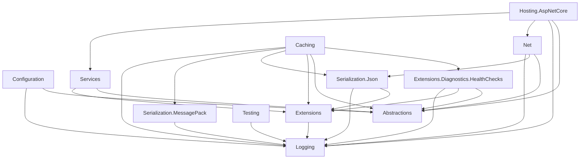

# CasCap.Common

CasCap.Common is a collection of C#/.NET NuGet libraries for application developers, covering caching, configuration, HTTP clients, JSON and MessagePack serialization, logging, ASP.NET Core hosting, and testing.

[](https://github.com/f2calv/CasCap.Common/actions/workflows/ci.yml)
[](https://sonarcloud.io/dashboard?id=f2calv_CasCap.Common)

## Quick Start

Install the package for the capability you need. For example, add the JSON serialization helpers to an existing .NET project:

```bash
dotnet add package CasCap.Common.Serialization.Json
```

Use the extension methods to serialize and deserialize with `System.Text.Json`:

```csharp
using System;
using System.Collections.Generic;
using CasCap.Common.Extensions;

var settings = new Dictionary<string, string> { ["theme"] = "dark" };
var json = settings.ToJson();
var restored = json.FromJson<Dictionary<string, string>>();

Console.WriteLine(json);                // {"theme":"dark"}
Console.WriteLine(restored?["theme"]);   // dark
```

See the [JSON package documentation](src/CasCap.Common.Serialization.Json/README.md) for custom converters and additional helpers.

## Packages

Package names below link to their usage and configuration documentation; version badges link to NuGet.
Install the capabilities you need; NuGet resolves their dependencies.

| Package | Purpose | NuGet |
| --- | --- | --- |
| [CasCap.Common.Abstractions](src/CasCap.Common.Abstractions/README.md) | Shared interfaces for configuration, caching, features and notifications | [](https://www.nuget.org/packages/CasCap.Common.Abstractions) |
| [CasCap.Common.Caching](src/CasCap.Common.Caching/README.md) | Memory, disk and Redis caching with optional distributed locking | [](https://www.nuget.org/packages/CasCap.Common.Caching) |
| [CasCap.Common.Configuration](src/CasCap.Common.Configuration/README.md) | Configuration layering, Azure Key Vault integration and validated options binding | [](https://www.nuget.org/packages/CasCap.Common.Configuration) |
| [Runtime configuration](docs/runtime-configuration.md) | Source-only typed live controls, EF Core PostgreSQL/SQLite audit history and optional bounded Redis cache-aside | Unpublished; use source projects |
| [CasCap.Common.Extensions](src/CasCap.Common.Extensions/README.md) | General-purpose extension methods and utilities | [](https://www.nuget.org/packages/CasCap.Common.Extensions) |
| [CasCap.Common.Extensions.Diagnostics.HealthChecks](src/CasCap.Common.Extensions.Diagnostics.HealthChecks/README.md) | HTTP endpoint health checks and Kubernetes probe tags | [](https://www.nuget.org/packages/CasCap.Common.Extensions.Diagnostics.HealthChecks) |
| [CasCap.Common.Hosting.AspNetCore](src/CasCap.Common.Hosting.AspNetCore/README.md) | ASP.NET Core hosting with feature-gated controllers, Serilog and OpenTelemetry | [](https://www.nuget.org/packages/CasCap.Common.Hosting.AspNetCore) |
| [CasCap.Common.Logging](src/CasCap.Common.Logging/README.md) | Shared logger factory through `ApplicationLogging` | [](https://www.nuget.org/packages/CasCap.Common.Logging) |
| [CasCap.Common.Net](src/CasCap.Common.Net/README.md) | HTTP client base classes, authentication and Web API helpers | [](https://www.nuget.org/packages/CasCap.Common.Net) |
| [CasCap.Common.Serialization.Json](src/CasCap.Common.Serialization.Json/README.md) | `System.Text.Json` extensions and custom converters | [](https://www.nuget.org/packages/CasCap.Common.Serialization.Json) |
| [CasCap.Common.Serialization.MessagePack](src/CasCap.Common.Serialization.MessagePack/README.md) | MessagePack binary serialization helpers | [](https://www.nuget.org/packages/CasCap.Common.Serialization.MessagePack) |
| [CasCap.Common.Services](src/CasCap.Common.Services/README.md) | Feature-flag-driven background service activation | [](https://www.nuget.org/packages/CasCap.Common.Services) |
| [CasCap.Common.Testing](src/CasCap.Common.Testing/README.md) | xUnit v3 logging, conditional skips, HTTP stubs and temporary-file helpers | [](https://www.nuget.org/packages/CasCap.Common.Testing) |

### Target Frameworks

All libraries target .NET 8, 9 and 10. All except `Hosting.AspNetCore`, `Services` and `Testing` also target .NET Standard 2.0.
Individual APIs can have framework-specific availability; see the relevant package documentation.

## Dependency Graph

Arrows point from a library to its direct project dependencies. Node labels omit the common
`CasCap.Common.` prefix; external NuGet dependencies are not shown.



## Development

Building all target frameworks requires the .NET 10 SDK. Start the
[local dependencies](docker-compose.yml) before running integration tests. Run these commands from
the repository root:

```bash
dotnet restore
dotnet build --no-restore
docker compose --profile tests up -d --wait redis postgres-tests
dotnet test --no-build --max-parallel-test-modules 1
```

The test runner is Microsoft.Testing.Platform. Run test modules serially because caching tests
share Redis state. Use only a disposable test Redis instance: some tests clear cache databases.
See the [caching test documentation](src/CasCap.Common.Caching.Tests/README.md) for service requirements.

Stop the Compose services when finished:

```bash
docker compose down
```

## License

Released under the [MIT License](LICENSE).
