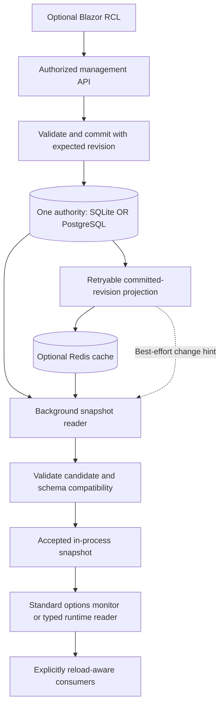

# ADR 0001: Durable Runtime Configuration and Optional Management UI

**Status:** Accepted core scope; implementation and verification progress is tracked below.
**Date:** 2026-10-24.
**Scope:** Package ownership, SQLite/PostgreSQL persistence, optional Redis acceleration,
typed configuration history, controlled .NET options reload, Kubernetes operation, an embeddable
Blazor management surface and optional Azure Table/Blob storage extensions.

This document records a small runtime-configuration subsystem alongside the existing configuration
helpers. Source implementation is not package publication or production rollout, and does not
make arbitrary application settings safe to change without restarting.

## Approved Completion Scope (2026-10-30)

Complete direct PostgreSQL/SQLite providers, the bounded optional Redis cache-aside mode,
reload-failure coverage and a small authorized management API with an embeddable typed Blazor
editor. Keep one registered DTO contract/scope per reader host; hosts own authentication,
authorization, environment selection and browser-safe DTO design.

Retain the existing append-only publication audit and read-by-revision capability. Dedicated
restoration, paginated/as-of history, comparisons, promotion and idempotent retry workflows are
far-future stretch goals, not core completion gates. Outbox projection, large-fleet performance
certification, Azure authorities, package publication and consumer deployment remain separately
approved optional work. No long-duration logging soak is required to complete this core scope.

## SQLite Provider Phase Evidence (2026-10-30)

- [x] The source-only .NET 10 [SQLite adapter](../src/CasCap.Common.Configuration.Sqlite/README.md)
  implements the shared typed publisher/store contract without adding Redis to direct consumers.
  The existing runtime codec, options reader and baseline-expiry behavior are reused.
- [x] Real externally applied EF Core 10.0.13 migrations own `cascap_config_revisions`,
  `cascap_config_heads` and `cascap_config_migrations_history`; SQLite's framework migrator
  additionally owns `__EFMigrationsLock`. Dedicated-file and shared-file tests preserve an
  unrelated application table, migrate repeatedly without drift and reopen published state.
- [x] Transactional journal/head publication has exactly one winner for first and existing heads.
  Tests exercise actual SQLite busy and shared-cache locked failures, explicit concurrency
  conflicts, no phantom append, and rollback when the head update fails. Other provider errors
  are not relabeled as concurrency conflicts. No automatic application retry is introduced.
- [x] Typed validation rejects invalid publications before append and invalid/version-incompatible
  stored candidates before activation. Historical read-by-revision and one/twenty arbitrary
  environments remain isolated across application and contract identifiers.
- [x] The permanent [host](../src/CasCap.Common.Configuration.TestHost/README.md) defaults to
  PostgreSQL and selects SQLite explicitly. Standard `WebApplicationFactory` tests cover direct
  and shared-Redis cache-aside paths, required initial publication, complete replacement, expiry
  to the distinct startup baseline and retained singleton identity. A warm cache cannot replace
  the required authoritative startup read; publishing remains uncached.
- [x] Local Release validation: all 18 focused SQLite cases and all 60 runtime cases passed,
  with zero failures/skips. The complete solution Release build passed with zero warnings/errors.
  Both SQLite and PostgreSQL model-drift checks and offline migration SQL generation passed;
  existing PostgreSQL migrations and schema mappings are unchanged.
- [x] The root [Compose profile](../docker-compose.yml) runs the actual embedded SQLite tests in
  an SDK runner with isolated writable file/build volumes and shared Redis, not a fictional
  database service. SQLite tests have no PostgreSQL fixture dependency. Existing solution-test
  CI discovery includes them; no remote workflow was started or observed.

This closes the SQLite provider implementation boundary, not the complete ADR. The authorized
management API and typed Blazor editor are next. Dedicated restore/as-of/paginated-history APIs,
outbox projection, package publication and live deployments remain deferred or separately approved.
SQLite lock waiting follows the configured connection timeout; native synchronous operations do
not provide a hard cancellation deadline. File ownership is not table-level authorization.

## First Implementation Slice (2026-10-25)

The approved first slice targets .NET 10, EF Core/PostgreSQL and the standard
`IOptionsMonitor<T>`, followed by an opt-in application logging soak. It ports the unpublished
prototype's complete dictionary replacement and standard provider integration, not its overlapping
timers, Dapper access, failure defaults or Redis-as-authority behavior.

- [x] [Runtime contracts and reader](../src/CasCap.Common.Configuration.Runtime/README.md) isolate one
  typed contract per host, validate complete snapshots and require an initial durable publication.
- [x] [PostgreSQL authority](../src/CasCap.Common.Configuration.PostgreSql/README.md) owns the
  `cascap_config` schema, scoped heads and audited snapshot revisions, with optimistic
  publication and historical reads.
- [x] [Acceptance tests](../src/CasCap.Common.Configuration.Runtime.Tests/README.md) and the permanent
  modern-hosting stub passed locally in Release: 38 cases, zero failures or skips, including the
  approved failure/cache trial below, using real PostgreSQL and Redis from root Compose.
  The complete Release solution build also passed with zero warnings or errors.
- [x] [Default CI wiring](../.github/workflows/ci.yml) includes the test projects, required PostgreSQL
  service and automatic-event test execution. Remote execution has not yet been observed.
- [x] Integrate opt-in logging control into the first consuming application and verify the actual
  logging pipeline, not just the options value. The local-only Debug integration passed a real
  PostgreSQL-to-Serilog test, including Microsoft logging-provider forwarding, retained category
  overrides and an unchanged process-cache sentinel. Nine existing endpoint smoke cases also passed
  with the feature disabled; both Debug and normal Release builds succeeded.
- [x] Provision the independently owned PostgreSQL migration and initial `Information` logging
  snapshot in the operator-approved existing database (2026-10-30). Read-back verified the migration
  history, revision 1 and matching head. This does not establish runtime activation or convergence.
- [x] Complete the approved two-minute live activation/expiry check (2026-10-30): both replicas
  changed from the verified `Information` startup baseline to temporary `Debug`, then returned to
  `Information` after expiry. Actual pipeline switches and probe-category Debug acceptance changed
  together, with unchanged pod/process identities, image and zero restarts; both health checks
  remained successful. Activation applied within 2.7 seconds of publication, and baseline return
  within 2.7 seconds after the recorded expiry, under healthy dependencies.
  The checked publication retained revision 1, appended revision 2 with exactly 120 seconds of
  lifetime, and left the head at revision 2 after expiry; read-back found no later publication.
- [ ] Complete any separately justified longer-duration or live failure exercise. The short live check
  does not prove exported log delivery, live cache retention, internal reader revision/fallback
  metadata, exact reconciliation timing or outage recovery. Local tests remain the evidence for
  emitted events, forwarding and the cache sentinel. Reusable isolated failure coverage is tracked
  separately below; a long soak is not a prerequisite for the small logging-level check.

For the initial live soak only, the operator approved reusing the host's existing application
database identity rather than provisioning a separate SELECT-only identity (2026-10-30).
This reduces credential-management work but does not reduce that account's existing privileges.
The reader performs reads; this is not database-enforced protection against journal mutation.
Revisit restricted reader permissions before broader rollout or the management-API phase.

Database changes, package publication and deployment still require explicit operational approval;
the first-slice scope is not blanket authorization. SQLite, Redis acceleration, UI, typed restoration,
paginated history and Azure authorities remain outside this first slice. The remainder records
the broader proposed direction, not completed features.

## Approved Cache-Aside Trial (2026-10-30)

After the live logging check, the operator approved an opt-in bounded Redis cache-aside trial and
additional direct-provider failure tests, not the outbox-backed projection proposed below.
The [consumer guide](runtime-configuration.md) is the implemented-feature entry point; the
[optional Redis project](../src/CasCap.Common.Configuration.Redis/README.md) composes the existing
shared caching library without adding Redis to direct PostgreSQL consumers.

The trigger is evaluating the optional architecture, not a demonstrated database bottleneck:
two hosts polling every five seconds issue approximately 0.4 aggregate reads per second.
No measured production benefit or Redis rollout is claimed.
PostgreSQL remains the only durable authority, and typed publication remains unchanged.
Startup always reads PostgreSQL; subsequent cache hits are validated and bounded by absolute age.
Each reader independently reconciles directly with PostgreSQL even if Redis remains available.

Default maximum cache age is 30 seconds with up to ten percent shorter jitter; default independent
reconciliation is one minute. Application/environment/contract/version plus a non-secret authority
identifier scope each hashed key and envelope. Deployments sharing Redis must supply distinct
authority identifiers for different durable databases/schemas.
Direct SQL and typed writes need not invalidate this trial's entries: accepted additional
staleness is cache age or independent reconciliation, followed by poll/source duration under healthy
dependencies. This is intentionally weaker than immediate invalidation or outbox delivery.
Stale refills cannot regress an already observed revision; malformed/mismatched cache entries or
Redis connection failures produce sanitized diagnostics and a direct durable read.
Shared cache connection registration still follows the host's timeout/abort-connect policy;
registration failures occur before the decorator can fall back.

This trial adds no outbox, fenced shared pointer, notification delivery guarantee or write
acknowledgment through Redis. Cache loss causes refill, never loss of accepted SQL history.
Full projection semantics remain a separate later choice, requiring measured benefit and their own
acceptance evidence. Application-specific logging tests stay in their consumer; reusable provider,
cache and stub-host tests live in CasCap.Common and join its existing default test path.

## Summary of the Proposed Decision

- Keep immutable deployment configuration as the default. Make live runtime controls an explicit,
  narrow application capability, not a global change to configuration semantics.
- Develop optional child packages in CasCap.Common first, rather than a separate repository.
  Keep database drivers, Redis and UI dependencies out of the existing configuration package.
- Use exactly one durable authority per configuration scope: initially SQLite **or** PostgreSQL.
  Redis is an optional cache and notification accelerator in front of that authority, never an
  independently editable configuration store. Azure Table and Azure Blob authorities are stretch
  goals, not additional required stores or dependencies of the initial providers.
- Support both a standalone configuration database and configuration tables within an existing
  application database. Use a dedicated PostgreSQL schema or SQLite table prefix for ownership.
- Use EF Core for SQLite and PostgreSQL persistence, with provider-specific mappings and migrations.
  Keep EF entities and contexts behind the typed configuration contracts.
- Support one or many host-defined environments, with no fixed names or built-in three-environment
  model. Isolate application/environment scopes even when their data shares one database.
  Storage location is not an environment boundary.
- Require every managed configuration section to have a registered strongly typed DTO and
  validators. Typed contracts span reads, edits, persistence binding and activation; arbitrary
  string key/value APIs are not the public programming model.
- Keep accepted snapshots in each process. Ordinary configuration and options reads perform no
  database or Redis I/O.
- Retain the existing append-only publication audit and typed read-by-revision. Dedicated restore,
  history browsing/as-of queries and replay workflows are far-future stretch goals. Any future
  restore must publish a new revision, never rewrite history; no event-sourcing framework is needed.
- Use the standard `IOptionsMonitor<T>` only for deliberately reloadable options. Validate a
  complete candidate before exposing it; do not assume the monitor supplies last-known-good,
  transactional resource replacement or cluster-wide consistency.
- Build the stretch-goal UI as a Razor class library (RCL) over an authorized server API. It is an
  opt-in application module, not a browser plugin with direct database access.
- Ship unit tests, real-store integration tests and a stub ASP.NET Core application exercised
  through `WebApplicationFactory`. Run all applicable suites by default in GitHub CI, backed by
  repository-owned PostgreSQL/Redis test services and isolated SQLite files.

## Context and Existing Fit

### Current Repository Capabilities

The following observations describe the current checkout, not the proposed subsystem:

| Existing surface | Current responsibility | Implication |
| --- | --- | --- |
| [CasCap.Common.Configuration](../src/CasCap.Common.Configuration/README.md) | Standard source layering, Azure Key Vault integration and validated options binding | Keep this as the deployment/bootstrap entry point; do not silently add runtime persistence |
| [Configuration builder helpers](../src/CasCap.Common.Configuration/Extensions/ConfigurationBuilderExtensions.cs) | JSON sources with reload enabled, optional user secrets, environment variables and optional Key Vault | File reload support already exists; its availability is not a recommendation to reload every Kubernetes setting |
| [Options registration helpers](../src/CasCap.Common.Configuration/Extensions/ConfigurationServiceCollectionExtensions.cs) | Standard options registration, startup validation and eager reads | Monitor availability does not make eager objects or `IOptions<T>` consumers live |
| [CasCap.Common.Caching](../src/CasCap.Common.Caching/README.md) | Local/Redis cache-aside, invalidation and distributed locking | Reuse appropriate cache infrastructure, but verify bootstrap order and revision guarantees before depending on it |
| [CasCap.Common.Services](../src/CasCap.Common.Services/README.md) | Select and launch background features at startup | Existing feature activation is not a live feature-flag engine or a safe worker stop/start protocol |
| [CasCap.Common.Hosting.AspNetCore](../src/CasCap.Common.Hosting.AspNetCore/README.md) | Optional ASP.NET Core hosting integration | A possible thin integration point, not a required dependency of the providers |

An unpublished provider prototype was inspected as input to this proposal. It currently has
independent Redis-hash and SQLite sources, basic reload tests and a sample combining the sources
through normal provider precedence. It has no PostgreSQL provider in the inspected project inventory.
Registering those two sources does **not** create a durable-store-plus-cache architecture.

The prototype needs a separate implementation review before adoption. Its useful starting point is
the standard `ConfigurationProvider` integration, not its existing consistency or failure semantics.
Do not copy unpublished source into this repository as part of this ADR.

### Three Different Kinds of Settings

| Kind | Examples | Authority and lifecycle |
| --- | --- | --- |
| Deployment configuration | Endpoints, credentials, provider connections, storage paths, host topology | Deployment sources and Key Vault; validate at startup and roll pods |
| Runtime operational controls | Logging thresholds, explicitly supported feature switches, bounded operational limits | Versioned durable runtime store; authorize, validate and apply without restart |
| Application/domain data | Tenant definitions, user preferences, workflow state, complex policies | Dedicated domain services and persistence, not an unrestricted `IConfiguration` editor |

Calling something a feature flag does not automatically make it safe to reload. A flag that changes
schema assumptions, security policy, worker ownership or cache interpretation needs a domain-specific
transition protocol. The first release should restrict itself to simple, explicitly supported controls.

## Repository and Package Ownership

### Alternatives

| Option | Advantages | Disadvantages | Assessment |
| --- | --- | --- | --- |
| Put all providers in the existing configuration package | Simple discovery and one install | Forces database/Redis dependencies on every consumer; mixes bootstrap and control-plane lifecycles | Reject |
| Optional child packages in CasCap.Common | Existing conventions, tests, release pipeline and nearby consumers; individually installable | Shared release train and growing maintenance surface | Recommend initially |
| Standalone configuration repository | Independent versions, ownership and product documentation | More CI, publication and dependency coordination before requirements are proven | Reconsider if it becomes an independent product |
| Separate configuration service immediately | Central control plane and language-neutral clients | Adds service availability, deployment and API-versioning costs | Defer until a concrete consumer requires it |

A separate NuGet package does not require a separate repository. Start where the configuration,
caching and hosting capabilities already live, while preserving dependency boundaries.
Move out only if the subsystem develops a separate owner/support policy, materially different
release cadence, non-.NET clients or a separately deployed control plane.

### Proposed Package Boundaries

All names in this table are proposals, not packages currently available on NuGet.

| Proposed package | Responsibility | Dependency boundary |
| --- | --- | --- |
| `CasCap.Common.Configuration.Runtime` | Typed snapshot/revision and scope contracts, DTO registration, validation and activation coordination, standard configuration adapter | Microsoft configuration/options primitives; no database, Redis, Azure or UI dependency |
| `CasCap.Common.Configuration.Sqlite` | EF Core SQLite store, transactional writes and revision polling | Runtime plus `Microsoft.EntityFrameworkCore.Sqlite` |
| `CasCap.Common.Configuration.PostgreSql` | EF Core PostgreSQL store, transactional writes, optional `LISTEN/NOTIFY` hints | Runtime plus `Npgsql.EntityFrameworkCore.PostgreSQL`; Npgsql for notification transport |
| `CasCap.Common.Configuration.Redis` | Optional version-aware cache decorator and notification hints for a durable store | Runtime plus shared Redis infrastructure where suitable; no Redis-only authority mode |
| `CasCap.Common.Configuration.Management` | Authorized ASP.NET Core management endpoints and write workflow | Runtime plus ASP.NET Core; no mandatory Blazor or opinionated host |
| `CasCap.Common.Configuration.Management.Contracts` | Browser-safe generic request/response envelopes, typed scope/revision identifiers and DTO-derived editor descriptors | Plain contracts only; no provider settings or storage dependencies |
| `CasCap.Common.Configuration.Blazor` | RCL components and typed management API client | Management contracts and Blazor; no database drivers, Redis or Key Vault SDK |

Introduce packages only with the phase that needs them. Keep provider-specific contracts in the
runtime package rather than expanding the general abstractions package speculatively.
The existing configuration package can retain its current dependencies and API.
Consumers should not need that package's Azure dependencies merely to use a database source.

Before finalizing the Redis dependency, inspect the shared caching implementation's connection
ownership, synchronous configuration bootstrap compatibility and version-aware publication support.
Reuse its cache-aside helper where it satisfies the contract; extend shared infrastructure when a
missing guarantee is reusable. Do not assume an unversioned cache helper solves configuration races,
and do not create a parallel connection-registration stack to bypass a bootstrap limitation.
Any necessary shared infrastructure change is an explicit prerequisite to the Redis phase.

The current configuration library targets .NET Standard 2.0 and .NET 8/9/10.
Do not automatically impose that entire matrix on new management/UI packages or silently narrow
existing targets. Inventory actual consumers and driver support first; propose modern supported
.NET targets for the new subsystem, recording the supported matrix before implementation.

## Service Architecture

This is a proposed architecture, not a diagram of the current implementation.

The two storage tiers are durable SQL and optional Redis. The in-process snapshot is always present,
not an optional third network tier. Redis accelerates startup, refresh fan-out and SQL load during
large rollouts; it cannot make an in-memory `IConfiguration` lookup faster.
Begin with direct SQL and measure before adding Redis for "extreme performance."

### Bootstrap and Configuration Precedence

1. Load deployment sources, environment variables and Key Vault using the existing bootstrap path.
   Resolve SQL/Redis connections, authentication, scope and refresh policy here.
2. Construct the durable store and optional cache using those immutable values. Never obtain a
   provider's own connection string or credentials from the provider being initialized.
3. Load and validate the initial runtime snapshot within an explicit startup deadline.
4. Start asynchronous refresh/reconciliation after initial loading, with host-owned cancellation
   and disposal. Standard `IConfigurationProvider.Load()` is synchronous: async stores require a
   deliberate bounded initial-load strategy, not blocking async calls on request paths.
5. Register reload-aware consumers explicitly; leave existing consumers and default source order
   unchanged unless an application opts in.

Prefer a separate runtime configuration root that contains only allowlisted controls. This isolates
its reload token from deployment and secret providers, and prevents a harmless flag update from
rebinding every application options type. It requires explicit options binding/change-token wiring
to that root; the existing ambient-root registration helper alone is not sufficient.

For a single-root integration, restrict the provider to registered keys, document its insertion
point and validate the **effective merged** candidate, not just its stored values.
Use this proposed precedence for eligible controls, from lowest to highest:

1. Code defaults and JSON/local/user-secret layers.
2. Durable runtime overrides.
3. Environment variables.
4. Key Vault, for keys it owns.
5. Explicit command-line overrides.

This is an opt-in composition policy, not the current helper's ordering. Appending a provider last
would otherwise let it override environment variables and secrets.
The UI must distinguish a stored override from the effective value and identify when a higher
priority source pins a value. Never expose secret values or a whole-root configuration debug view.
Prefer disjoint key ownership so secret/deployment keys cannot enter the runtime store at all.
An invalid effective override rejects activation; it is not silently discarded.

### Strongly Typed Configuration Contract

Every managed section must bind to an explicitly registered configuration DTO before it can be
read by application code, edited, committed or activated. A dictionary of string keys and string
values is not an acceptable application-facing contract. Legitimately textual properties remain
strings; booleans, enums, numbers and durations retain their actual types rather than being
stringified throughout the system.

- Applications own their configuration DTOs and register each with a stable contract identifier,
  contract version, validators and editable-property policy. Resolve only registered contracts;
  never instantiate an arbitrary CLR type named by a request or stored payload.
- Expose typed operations such as `Read<TConfig>` and `Publish<TConfig>` with typed DTO values,
  validated scope identifiers and revision tokens. Avoid `Get(string key)`, `Set(string key,
  string value)`, `object` bags and caller-supplied SQL as public read/write APIs.
- Publish a complete typed candidate, or an explicitly modeled typed override DTO with property
  presence. Distinguish "not overridden", explicit null and a property's default value. Do not
  infer presence from null/default or recreate arbitrary path/value patches as a second API.
- Use immutable DTO snapshots with typed nested members and collections where supported. Capture
  the aggregate once per operation; never mutate an accepted DTO in place.
- Validate required members, numeric ranges, defined enum values, nested objects, collection limits,
  cross-property rules and application-specific constraints. Data annotations alone do not
  recursively validate arbitrary nested graphs; run explicit nested validation and registered
  `IValidateOptions<T>` or equivalent shared validators.
- Use one authoritative server-side validation pipeline for writes, initial load, refresh and
  rollback. Bind the fully merged effective candidate and validate again before activation.
  Reject unknown members, malformed types and incompatible contract versions explicitly; do not
  silently coerce invalid values or ignore misspelled properties.
- Persist a versioned serialized representation of the registered DTO or typed override DTO
  (for example JSON text in SQLite or JSONB in PostgreSQL), not CLR assembly-qualified type names.
  Serialization is a storage/transport boundary, not permission to pass unvalidated raw JSON or
  string dictionaries through application services. Deserialize and validate before use.
- Keep string paths and scalar formatting confined to the standard `IConfiguration` adapter and
  serializer. Derive paths and editor metadata from registered DTO members; consumers use
  `IOptions<T>`, `IOptionsMonitor<T>` or a typed runtime reader instead of string-key lookups.
- Browser-editable DTOs belong in an application-owned, browser-safe contracts assembly. Shared
  library envelopes can be generic, but must not force application-specific settings into
  CasCap.Common or include server provider/credential DTOs in a WASM download.

For existing logging and feature-management integrations, map a registered typed control DTO into
the framework's configuration shape at the adapter boundary. Do not make a generic string editor
an exception merely because an underlying framework accepts string keys.

### Database Placement and Ownership

Both durable providers must support a standalone database and an existing application database
without changing the typed API, scope semantics or optional Redis behavior.

| Placement | PostgreSQL | SQLite |
| --- | --- | --- |
| Standalone configuration database | Dedicated database with an owned configuration schema | Dedicated configuration file with owned prefixed tables |
| Existing application database | Same database, separate owned configuration schema | Same file, separate owned prefixed tables |

Recommend `cascap_config` as the default PostgreSQL schema, configurable through immutable
deployment options. Qualify all provider-owned tables, indexes, migration history and outbox objects
explicitly; do not rely on a mutable `search_path` or create them in the application's default
schema. Validate/quote configured SQL identifiers through provider-safe mechanisms; they are not
administrative UI inputs.

SQLite has no equivalent independently permissioned schema within one database file. Use a
consistent configurable prefix such as `cascap_config_` for tables, indexes and migration
history instead of pretending PostgreSQL schema isolation is portable or requiring `ATTACH`.
Sharing a SQLite file shares file-level permissions and writer contention.

Own and version the add-on's migrations independently, while letting the host orchestrate their
execution. Never inspect, rename or alter unrelated application tables. Separate configuration
transactions from application business transactions unless a future explicit contract requires
otherwise; sharing a database does not imply sharing a unit of work.
Use separate least-privilege reader, writer and migration credentials where PostgreSQL permits.
A schema indicates ownership and enables grants; it does not provide resource, failure or backup
isolation. Dedicated databases remain available where those stronger operational boundaries matter.

### EF Core Persistence

Both durable providers implement data access through EF Core. Do not introduce a parallel Dapper,
handwritten ADO.NET CRUD or generic SQL-query persistence path. Provider-native operations such as
PostgreSQL notification transport remain narrowly scoped infrastructure, not an alternate store.

- Use a dedicated configuration `DbContext` with explicit entity mappings for scopes, revisions,
  typed-section payloads, current pointers, audit records and outbox entries. These persistence
  entities are internal storage models, not the configuration DTOs or browser contracts.
- Sharing an existing database means sharing its connection target, not requiring the host to add
  configuration entities to its business `DbContext`. Keep change tracking, transactions and
  migration history independently owned by the add-on.
- Obtain short-lived contexts through `IDbContextFactory<TContext>` or an equivalent explicit
  operation scope. Singleton providers, refresh loops and concurrent requests must never share a
  long-lived context. Use no-tracking projections for snapshot/revision reads and asynchronous
  operations with cancellation outside the bounded initial configuration-loading boundary.
- Model expected-revision concurrency explicitly with EF Core concurrency tokens and database
  constraints. Translate an actual concurrency conflict into the typed conflict outcome; do not
  hide it with unconditional retries or last-write-wins saves. Commit revision, current pointer,
  audit and outbox changes in one EF-managed database transaction.
- Maintain provider-specific migrations/model snapshots for SQLite and PostgreSQL. Map PostgreSQL
  identifiers to `snake_case`, configure the owned schema/migration-history location and map the
  SQLite table prefix explicitly. Account for configured identifiers in EF model caching and
  migration artifacts; do not assume a migration generated for one schema/prefix automatically
  retargets to another.
- Scaffold migrations from the current model and check model/migration drift in CI for both
  providers. Apply reviewed migrations externally before production rollout, with expand/contract
  compatibility for mixed application versions. Do not use `EnsureCreated` as a replacement for
  migrations or let normal production pods migrate on startup.
- Keep EF Core versions aligned with the selected .NET targets and both provider packages through
  central package management. The runtime contracts, Redis decorator and browser contracts remain
  independent of EF Core; do not expose `DbContext`, `IQueryable` or tracked entities in their APIs.

### Application and Environment Isolation

Treat scope as a required typed value containing at least an application identifier and an explicit
environment identifier. Each application may have one environment, twenty or another deployment-
defined count; do not encode a fixed set, count or environment enum in the library, database or UI.
Names such as `tst`, `int` and `prd` are examples only, not reserved names or required lifecycle
stages. A shared database may hold any registered environment scopes concurrently.
Validate/canonicalize identifiers once and use an unambiguous encoding at storage boundaries.
Map host environment names to these identifiers explicitly in deployment configuration; do not
silently equate `Production` with `prd`, infer scope from a connection string or default a missing
environment to production.

- Scope all revision/current-pointer keys, uniqueness constraints, foreign keys, audit records,
  outbox entries and idempotency identifiers by application and environment. Independent scopes
  can have independent revision sequences without collisions.
- Require scope predicates on every SQL read/write/history/rollback operation. Bind normal runtime
  readers to their immutable deployment scope; a browser request cannot switch a running pod's
  environment.
- Carry the same scope through Redis cache keys, pointer updates, notifications, local snapshot
  caches and convergence reporting. Validate it on received envelopes before any activation.
- Authorize management access per application, environment and operation. An operator allowed to
  edit `tst` is not implicitly allowed to edit `prd`. PostgreSQL grants/row-level security can add
  defense in depth; schema names or UI filtering alone are not access control.
- A missing environment snapshot is an explicit absence/failure under the declared startup policy,
  not a reason to read another environment. Do not introduce implicit cross-environment inheritance.
- Promotion between environments is an explicit authorized publish into the destination scope,
  using its expected revision and validators, with destination audit history. It does not move a
  shared pointer or copy credentials.

Use one configuration schema/prefix across environments by default, with row-level scope
partitioning. Separate schemas or databases per environment can strengthen isolation, but are not
required for multi-environment correctness. Administrative UI selection must clearly display the
target application/environment throughout preview and confirmation.

### Durable Data Model and Write Contract

The minimum model is a configuration scope, immutable revisions and a current-revision pointer.
Each scoped revision contains registered typed sections; tenant-specific mutable policy remains
outside the initial scope. Scope identifiers are authorization targets, not proof of access.
Revision rows also form the authoritative publication-event journal described below; do not create
a second independent event store containing competing copies of the same history.

- A revision contains the storage format version, registered DTO contract versions, a complete
  bounded set of serialized typed sections/overrides, predecessor, UTC timestamp, change reason
  and a minimal access-controlled audit actor reference.
- Writers submit an expected current revision. Compare-and-swap, revision contents, current pointer
  and audit entry commit in one SQL transaction. Concurrent writers receive a conflict, not
  last-write-wins data loss. Retried requests use an idempotency identifier.
- At the configuration adapter boundary, normalize generated keys case-insensitively, reject
  collisions and use standard colon-delimited paths with invariant-culture scalar representations.
- Define clearing a typed override as allowing a lower-priority value to reappear. Define null and
  collection replacement explicitly in the DTO/adapter contract; flattened configuration does not
  inherently support deleting an entire lower-priority array. The initial editor should reject
  unsupported shapes rather than claiming to replace them.
- Production schema migration is a separate privileged operation, not automatic table creation
  during a read. Runtime readers use read-only credentials wherever feasible.
- Never edit an old revision. Rollback publishes the selected historical content as a **new**
  revision with a new concurrency token and audit entry.
- Bound snapshot size, section/member count, collection/string lengths and history retention. Back up the authority and
  verify restore behavior; a restored store needs a new generation identifier so revision ordering
  cannot confuse surviving caches or running pods.

Treat revision order as monotonic within a scope and store generation. Validate data and pointer
from one consistent database snapshot so a reader never assembles parts of different revisions.

### Audit History and Lightweight Event Sourcing

The append-only audit and typed read-by-revision are current behavior. The richer history,
restoration, idempotency, projection-rebuild and archival design in this section is **deferred
far-future work**, not a prerequisite for the approved core or its editor.

The initial design is **snapshot-carrying publication events**, not property-by-property event
patches or a generic event-sourcing framework. Each successful publish appends one immutable
versioned record containing the complete typed stored configuration/override state and audit
metadata. The current pointer is its rebuildable read projection. This supplies event-sourcing-like
history and deterministic reconstruction without an external event store, broker or library.
EF Core and the SQL authority implement this directly.

| Approach | Assessment |
| --- | --- |
| Overwrite current values and record a text change log | Reject: insufficient typed historical state and unreliable reconstruction |
| Append complete typed publication records | Recommend: simple historical reads, independent revisions and straightforward restore |
| Replay granular property-change events | Defer: more payload evolution, ordering and replay complexity without a demonstrated need |

- Use stable registered event kinds such as publish and restore, with explicit envelope and DTO
  contract versions. Include event/revision identity, scope, sequence, predecessor, UTC recorded
  time, idempotency identifier, authenticated actor reference and reason. A restore additionally
  identifies its source historical revision.
- Allocate sequence/order and compare the expected head in the durable transaction. Do not derive
  authoritative ordering from timestamps, process-local counters or notification arrival order.
  The journal insert, head update, audit metadata and SQL outbox entry succeed or fail together.
- Never update/delete journal payloads as part of an ordinary edit. Restrict permissions so the
  runtime reader cannot change history and ordinary writers cannot rewrite prior revisions.
  Append-only application behavior is not a claim of tamper-proof storage against a database
  administrator; stronger compliance requirements need separately evaluated controls.
- Expose typed, authorized, paginated history, read-by-revision and as-of-recorded-time queries.
  Sequence resolves equal timestamps. Return the original typed stored state, provenance and
  a DTO-aware comparison; do not reduce history to free-form audit messages.
- Rebuild the current projection from the committed journal deterministically. Full-state events
  allow selecting the target revision directly rather than replaying every change at startup.
  Historical reconstruction is side-effect-free: it must not resend notifications, rerun logging
  changes or apply old settings to a live application.
- Distinguish stored runtime history from historical effective application configuration.
  An old runtime DTO does not recreate the old image, code defaults, environment variables,
  command-line overrides or Key Vault contents. Record safe release/contract provenance and
  explain this limit; never archive credentials merely to claim complete historical reproduction.
- Restore validates the historical content against today's registered DTO contract, current
  precedence and safety rules, then publishes it with the destination scope's expected current
  revision. Incompatible historical contracts require an explicit supported typed conversion or
  rejection, never silent coercion. Retain the original payload/version for authorized history.
- Restoration always advances the journal/head and normal propagation path; it does not point a
  live pod backward to an old sequence or bypass audit, authorization or concurrency checks.
  Keep accepted/applied replica status distinct from the committed publication journal.
- Retain complete publication history by default. Any retention/archive policy must be explicit
  and preserve a way to read retained historical content and its chain/provenance. Do not silently
  prune history using Redis TTLs or compact it into current state only. State clearly when an
  archived revision is unavailable for immediate restore.

Use ordinary records, serialization, EF Core mappings and narrowly scoped replay/projection logic.
Do not add third-party event-sourcing packages or build a reusable event-processing framework as a
prerequisite. Reconsider granular events only if measured history size or another concrete
requirement outweighs their additional contract-evolution burden.

### SQLite and PostgreSQL Deployment Shapes

| Backend | Appropriate use | Operational limits |
| --- | --- | --- |
| SQLite direct | Development, embedded/edge applications, a single authoritative process with durable local storage | One writer at a time; file permissions, busy handling, backup and WAL checkpointing matter |
| PostgreSQL direct | Multi-replica Kubernetes applications and shared configuration across hosts | Connection budgets, migrations, primary failover and bounded revision checks |
| SQLite with Redis | Several readers accelerating access to one explicitly owned SQLite authority | Redis does not replicate independent SQLite files or make SQLite highly available |
| PostgreSQL with Redis | Large reader fleets or measured startup/reconciliation SQL pressure | More moving parts and bounded staleness; SQL remains required for writes |

Do not give every pod its own SQLite authority and expect Redis to reconcile them.
Do not put a writable SQLite WAL database on a multi-node shared network filesystem:
[WAL requires processes on the same host](https://www.sqlite.org/wal.html).
For genuinely highly available multi-pod operation, prefer PostgreSQL. A single SQLite-owning service
with remote readers is possible, but adds a service/API contract and a single-authority availability
constraint; it is not part of the initial embedded provider design.

## Stretch Goal: Azure Table and Azure Blob Authorities

Optional Azure Table Storage and Azure Blob Storage adapters may implement the same typed,
scoped, versioned history/read/write contract. Treat them as alternative durable authorities,
not replacements for Key Vault, a new secret store or required companions to SQL.
The initial SQLite/PostgreSQL implementation remains EF Core-backed; these future non-relational
adapters use the official Azure SDKs rather than pretending a supported EF relational provider exists.

Candidate optional packages are `CasCap.Common.Configuration.AzureTable` and
`CasCap.Common.Configuration.AzureBlob`. Neither is part of the initial delivery or added to the
existing configuration package by default. Immutable deployment configuration supplies identity,
endpoint, storage namespace and scope; use least-privilege authentication and keep credentials
out of DTOs, browser assets and revision history.

| Candidate authority | Possible implementation | Constraints to prove before acceptance |
| --- | --- | --- |
| Azure Table Storage | Immutable publication entities plus a scoped head entity; conditional ETags and a same-partition transaction | Partition by configuration scope, respect entity/batch limits, and commit publication/head/audit/recoverable propagation metadata atomically |
| Azure Blob Storage | Immutable typed revision documents and an ETag-conditional scoped head manifest | A revision upload alone is not a publish; conditional manifest advancement is the commit boundary, with a recoverable history chain and propagation work |

For Table Storage, all entities in an
[entity-group transaction](https://learn.microsoft.com/en-us/rest/api/storageservices/performing-entity-group-transactions)
must share the same table and partition. Reject unsupported oversized atomic publications rather
than silently splitting them into partially committed transactions.
For Blob Storage, use
[conditional writes](https://learn.microsoft.com/en-us/azure/storage/blobs/concurrency-manage)
to prevent concurrent writers overwriting the head. An upload that loses the head comparison can
leave an uncommitted orphan; it is not visible history and requires safe, reference-aware cleanup.
Do not infer application audit history from storage-account blob versioning alone.

Neither adapter can assume SQL transactions or a cross-resource transaction between Table, Blob
and Redis. Define and test its own durable commit/recovery boundary before exposing write support.
A combined Table-metadata/Blob-payload design adds another coordination problem and is not the
default proposal. Keep the same contract guarantees or explicitly defer the adapter; do not
silently weaken audit completeness, atomic publication or stale-write detection.

Redis remains optional in front of an Azure authority only after its publication/reconciliation
semantics are proven; there is still exactly one selected authority per scope.
Notifications are optional acceleration, with periodic authority checks as the baseline.
Azure adapters are a later phase, not a reason to generalize SQL persistence prematurely.

## Change Propagation and Redis Correctness

### Direct SQL Mode

Use a cancellable, non-overlapping background loop. Check the current revision with bounded,
jittered intervals and fetch a snapshot only when it changes.
PostgreSQL `LISTEN/NOTIFY` may reduce reaction time, but is a hint followed by a revision read.
Subscribe and reconcile on startup and reconnect to close the initial subscription race.
Polling is still the recovery mechanism after missed notifications.

### Bounded Cache-Aside Trial

The approved trial above reuses shared cache-aside fill/stampede protection. It permits bounded
stale cache contents and does not rely on writer invalidation. Every reader bypasses the cache
independently, and required startup remains authoritative. It does not claim the stronger publication
protocol below. See the [trial contract](../src/CasCap.Common.Configuration.Redis/README.md).

### Later Outbox-Backed Redis Mode

The SQL transaction is the only write acknowledgment boundary. Never write Redis first or report a
SQL failure as success because the cache changed.

1. Commit the durable revision and an outbox entry in one transaction.
2. A retryable projector reads committed revisions, publishes an immutable versioned cache entry,
   then conditionally advances a cached current pointer and emits a revision hint.
3. Late projectors cannot move the pointer backward. Pointer updates and entry visibility must
   obey an explicit atomic publication protocol, including Redis Cluster slot constraints if used.
4. Readers receiving hints coalesce refresh work and load complete snapshots. A missing pointer or
   snapshot falls through to SQL. Cache refill cannot overwrite a newer published pointer.
5. Every reader independently reconciles the durable current revision at a bounded interval.
   Re-reading Redis alone cannot detect a lost projection or an indefinitely stale pointer.

Use shared cache-aside primitives for ordinary refill/stampede protection, but do not equate cache
deletion with a correctness protocol: a reader holding an old SQL result can repopulate stale data
after deletion. Versioned snapshots, fenced pointer updates and durable reconciliation address that
race. Redis locks are not the authority for writer serialization; SQL concurrency control is.

Redis entries have the **cache** role: evictable, rebuildable, bounded in size and carrying absolute
expiry with jitter. The authoritative audit trail and revisions do not live in Redis.
Scope cache keys and channels by authority/schema namespace, application and environment to prevent
cross-database and cross-environment collisions; pub/sub is not isolated by Redis database number.
Reuse shared key/connection conventions when implementing the adapter.
Do not require server-wide keyspace notifications or Redis administrative permissions.

[Redis pub/sub is at-most-once](https://redis.io/docs/latest/develop/pubsub/).
Neither Redis events nor PostgreSQL notifications constitute durable delivery or replica
acknowledgment. An outbox survives a writer crash after SQL commit; periodic reconciliation remains
the final safety net. A replicated Redis pointer may regress after failover: running readers reject
older revisions, while cold-start cache reads require authority verification or an explicitly
approved bounded-stale startup policy.

### Activation and Consistency

Build an immutable typed candidate outside the active provider. Check application/environment
scope, generation, storage format and DTO contract versions, registered members, complete effective
binding and all applicable validators before publication.
Reject malformed, incompatible or older candidates without replacing the accepted snapshot.
Use the same validation rules for administrative writes and consumer-side activation; consumer
validation remains necessary during mixed-version releases or manual database intervention.

Publish one snapshot reference, then issue one reload signal for an actual effective change.
Do not raise reloads on every successful poll. Serialize refreshes and bound callback work.
An atomic provider dictionary swap does not make a series of separate configuration-key reads
transactional. For coupled controls use one aggregate typed snapshot, captured once per operation.
Independent `IOptionsMonitor<T>` instances do not form a transaction.

Each replica eventually converges, not simultaneously. Track durable desired revision, locally
accepted revision and application-applied revision separately. Administrative success means
"committed"; the UI reports convergence separately and must not claim all pods applied a change.
Strict all-replica barriers and instantaneous safety kill switches require another protocol;
use application/data-plane enforcement where eventual consistency is insufficient.

## IOptionsMonitor in Kubernetes-Native Backends

Immutable container images and mutable operational controls can coexist. What changes is the
reproducibility boundary: release identity alone no longer explains behavior; include the runtime
revision in diagnostics. A live edit should be exceptional and auditable, not a replacement for
normal deployment configuration and rolling updates.

### Benefits and Costs

| Benefit | Why it matters | Condition |
| --- | --- | --- |
| Faster diagnosis | Raise logging levels without waiting for a rollout | Existing logger supports that specific live change; changes are time-bounded |
| Preserve warm process state | Avoid discarding hot local caches and increasing database load | Reload does not itself invalidate caches or change their meaning |
| Avoid unnecessary replica churn | An operational adjustment need not replace healthy pods | Consumers already implement a safe transition |
| Faster feature control | Disable an explicitly reloadable path without rebuilding | Server-side evaluation and a documented propagation bound |
| Singleton compatibility | A monitor can supply updated values to long-lived services | Consumers read current snapshots rather than retaining the initial object |

| Cost or risk | Consequence | Required mitigation |
| --- | --- | --- |
| Runtime drift | Identical pod images behave differently | Desired/accepted/applied revision visibility and audit history |
| Partial fleet convergence | Old and new behavior coexist | Tolerate bounded inconsistency; do not promise instant global changes |
| Resource lifetime mismatch | Existing clients, pools or workers keep old settings | Keep these startup-only or design explicit create/swap/drain ownership |
| Validation failure | Rebinding can throw after cache invalidation | Validate before publication and retain the accepted snapshot explicitly |
| Concurrency and callback errors | Inconsistent reads, blocked reloads or failed apply | Aggregate snapshots, short callbacks and supervised serialized application |
| Larger failure surface | Store outages affect configuration refresh | Last-known-good policy, bounded retries and separate readiness rules |
| Diagnostic leakage/cost | Verbose logs reveal content or overload sinks | Restrict allowed levels/categories, redact content and enforce expiry |
| Operational burden | Dynamic changes bypass ordinary release review | Authorization, reason, rollback and optional approval for risky controls |

### What the Standard Options Interfaces Actually Guarantee

- `IOptions<T>` caches an instance and does not automatically follow reload tokens. Eagerly bound
  objects also remain snapshots. Validate and access deployment options during startup if they
  must represent startup state rather than a later first read.
- `IOptionsSnapshot<T>` is scoped and recomputed for a new scope; it is not suitable for injection
  into singleton workers and is not a cluster consistency mechanism.
- `IOptionsMonitor<T>` is singleton-compatible and reacts to provider change tokens. Keeping
  `CurrentValue` in a field forever defeats live reads. Capture one reference per logical operation.
- Standard monitor invalidation removes the cached instance before recreating and validating it.
  Validation failure can therefore make `CurrentValue` throw; it does **not** guarantee retention
  of the previous valid value. See the
  [.NET implementation](https://github.com/dotnet/runtime/blob/v10.0.0/src/libraries/Microsoft.Extensions.Options/src/OptionsMonitor.cs).
- `ValidateOnStart` is not an activation transaction. Revalidation does not safely rebuild resources,
  invoke compensating actions or coordinate other monitors.
- `OnChange` is a notification callback, not an awaited asynchronous deployment hook. Do not perform
  blocking network work or use `async void` there. Enqueue a bounded/coalesced apply request,
  supervise failures, and dispose registrations with their owner.

Use a prevalidated runtime root with the standard monitor for simple controls. Do not introduce a
custom `IOptionsMonitor<T>` to hide failures. For an operation that needs stronger last-known-good
application semantics, let a dedicated typed runtime-state service own validation, activation and
the accepted reference; use a monitor only as a notification/input adapter where helpful.
Prevalidation protects against invalid input, not arbitrary listener exceptions or apply failures:
record those separately and retain the last successfully applied application state.

### Explicitly Supported and Unsupported Live Changes

| Control | Initial position |
| --- | --- |
| Existing logging category threshold or registered level switch | Good candidate; verify Microsoft logging or the chosen Serilog integration actually reloads it |
| New logging sinks, credentials or pipeline topology | Restart-required unless a separate lifecycle design proves safe |
| Simple request-path feature flag | Candidate; evaluate through Microsoft.FeatureManagement where appropriate and keep a consistent decision within an operation |
| Background worker activation | Restart-required with the current launcher; dynamic start/stop/drain requires a separate design |
| Database/Redis connection, authentication, encryption or storage path | Startup-only; roll pods |
| Cache expiry or interpretation changes | Case-by-case; assess existing entries and cache versioning before permitting reload |
| Tenant definitions or complex authorization policy | Dedicated domain service, not a generic options editor |

Preserving a warm cache is a legitimate availability objective, but `IOptionsMonitor<T>` does not
preserve cache correctness automatically. A change that alters cached data semantics may require
targeted invalidation or a versioned cache namespace even if the pod stays alive.
Compare this complexity with rolling updates, readiness gates, disruption budgets, staged warm-up
and shared caching before deciding live configuration is necessary.

## Failure Policy and Kubernetes Operation

| Situation | Proposed behavior |
| --- | --- |
| First startup with no accepted snapshot and SQL unavailable | Fail startup within a deadline; no empty/default success fallback |
| Startup with Redis unavailable but SQL healthy | Read SQL and report degraded acceleration, not failed correctness |
| Refresh fails after a valid activation | Keep last-known-good; emit sanitized diagnostics and track staleness |
| Invalid or incompatible revision | Reject activation, preserve applied state and expose a rejection reason without values |
| SQL write unavailable | Reject the management write explicitly; never queue an acknowledged Redis-only edit |
| SQL commit succeeds but Redis projection fails | Report committed with propagation pending; retry outbox and reconcile |
| All stores unavailable beyond allowed staleness | Follow the control's declared policy: continue for benign diagnostics or fail readiness/restrict affected operations for safety-sensitive controls |
| Subscriber reconnect, Redis flush/eviction or failover | Reconcile against SQL and rebuild cache; do not clear application data caches |

Set startup deadlines, poll intervals, jitter, maximum staleness and retry budgets in immutable
deployment configuration. A required setting cannot silently become optional on refresh failure.
Any approved offline startup mode needs an authenticated, compatible snapshot and explicit freshness
limits; an arbitrary old cache entry is not sufficient.

Keep liveness independent of temporary store outages to avoid restart storms and cold-cache
database spikes. Readiness depends on whether the current applied state remains safe, not merely
whether Redis answers. Export refresh failures, rejected revisions, snapshot age and propagation
lag; keep unbounded revision/actor identifiers out of metric labels.

Logging overrides should expire durably and produce a new reverting revision so reconnecting pods
recover the intended level. Set a local expiry safety bound as well, because a disconnected pod
cannot rely on receiving that reverting revision. Do not log configuration payloads, credentials
or third-party content as a side effect of changing verbosity.

## Optional Blazor Management Module

### Integration Model

The selected first management-UI candidate is agentizr, which already has a
[Blazor WebAssembly client](https://github.com/f2calv/agentizr/blob/main/src/CasCap.App.Client/CasCap.App.Client.csproj).
This host choice was confirmed on 2026-10-30; it does not expand the current logging-only backend
soak into UI implementation. After that soak, evaluate embedding the optional management module
in the existing frontend rather than creating a separate portal. Keep the reusable components and
typed API client host-independent, with provider access and authorization enforced on the server.

An RCL provides components such as a settings grid, constrained editors, revision history and
convergence indicators. The host explicitly references it, registers its typed HTTP client, mounts
the page and supplies authorization policies. No runtime assembly discovery or downloaded arbitrary
plugins are needed. Static assets ship through normal RCL packaging.

Existing Blazor WebAssembly and Blazor Web Apps can embed the components. Interactive WebAssembly
is a good fit for interchangeable Kubernetes replicas because there is no server circuit to move.
Keep components render-mode-neutral where practical; the host owns routing, navigation and render
mode. A standalone WASM frontend needs a separately hosted authorized API and an explicit origin/
authentication design, not access to provider connections.

The browser receives only registered browser-safe configuration DTOs, DTO-derived editor descriptors,
typed scope/revision envelopes and sanitized outcomes. It never receives SQL/Redis/Key Vault credentials,
connection strings, arbitrary queries, entity serialization or the full configuration root.

### Server and UI Contract

- Hosts register editable DTOs and derive controls from their typed members and validation metadata,
  adding descriptions, risk, scope and restart requirements where necessary. Start with booleans,
  enums and bounded scalars. Do not maintain a separate arbitrary key/string-value catalogue.
  Components retain member types through editing and submit typed DTO candidates; metadata-driven
  forms must not erase this contract into a dictionary of strings.
  Server-side descriptors and validators are authoritative; UI validation is only usability.
- Core operations are read, typed validation/preview and expected-revision publish. The host chooses
  which DTO is browser-safe and supplies typed editor fields; no arbitrary key/string setter exists.
  History browsing, comparisons, as-of views, restore and promotion are far-future enhancements.
  Display the registered destination scope explicitly; a reader host manages its one registered
  scope, not arbitrary environments supplied by the browser.
- Publish uses an expected revision (`If-Match`/ETag or equivalent); stale edits return a conflict
  with a safe rebase workflow. Rollback is a new publish, not a history rewrite.
- Report validation failures, authorization failures, conflicts, store outages and committed-but-
  pending propagation distinctly. Never show a generic success toast for a failed activation.
- Bind the audit actor from the authenticated principal, not the submitted form. Restrict audit
  access and retention; avoid storing secrets or sensitive values in history in the first place.
- Authorization is server-enforced for each scope and operation. Separate viewing, editing and
  high-risk publishing permissions, including environment-specific grants. A hidden button or
  environment dropdown is not authorization.
- For same-origin cookie-authenticated apps, require antiforgery on mutations, secure host-owned
  authentication and API 401/403 responses. Do not change existing machine API authentication.
  Bearer-token hosts need their own explicit browser credential/origin policy.
- Keep the API stateless across replicas. Shared cookie/Data Protection keys, idempotent publishes
  and mixed-version static-asset behavior remain host deployment responsibilities.

Adopt [Microsoft.FeatureManagement](https://learn.microsoft.com/en-us/azure/azure-app-configuration/feature-management-dotnet-reference)
for evaluation semantics where it fits instead of inventing another flag engine.
It can consume configuration independently of choosing Azure App Configuration as the store.
Do not send internal targeting rules to the browser, and enforce feature decisions again on the
server. A flag is not an authorization check.

## Prototype Deep-Dive Backlog

These observations are investigation inputs, not a completed audit or approved code changes.
Keep the deep dive scoped to reusable provider behavior and avoid preserving experimental APIs
merely for compatibility.

| Area observed in the prototype | Required investigation or improvement |
| --- | --- |
| Redis is a directly editable hash; SQLite is a separate source | Replace provider precedence as the data model with one durable authority and an optional decorator |
| Redis notification channel selects database zero | Verify configured database/namespace handling, reconnects, deletion/expiry and missed-event recovery |
| Notification processing sleeps before reloading | Replace timing assumptions with revision publication and cancellable/coalesced refresh |
| Optional-load catches replace data with an empty dictionary | Separate optional absence from operational failure and preserve accepted state on refresh errors |
| SQLite timer raises reload after each load | Detect actual revisions/effective changes and prevent overlapping polls |
| Dictionary replacement removes deleted entries | Preserve this useful behavior, then specify null, array and lower-provider fallback semantics |
| Read paths can create tables or placeholder data | Separate schema/provisioning ownership from read-only runtime loading |
| Redis provider owns connection creation and disposal | Align connection ownership/reconnect behavior with shared caching and bootstrap design |
| Current tests cover basic loads and single updates | Add adversarial ordering, failure, disposal, convergence and effective-precedence coverage |
| No PostgreSQL implementation in the inspected inventory | Implement against the agreed snapshot contract rather than copying SQL dialect assumptions |

Before importing any unpublished implementation, establish provenance and permission to publish,
review dependencies/licensing, remove local identifiers and settings, and define the new public API.

## Required Test Harness, Compose Support and CI

Tests are part of each provider's delivery, not a follow-up after a package or UI release.
Use the repository's xUnit v3 / Microsoft.Testing.Platform runner, central dependency management
and existing unit/integration folder conventions. Add every test project and the non-packable stub
application under `src/` to the solution built by CI, with documentation for local prerequisites.

### Unit and Real-Store Integration Suites

| Suite | Dependencies | Required coverage |
| --- | --- | --- |
| Runtime unit tests | Deterministic fakes; no network or host | DTO validation, typed override presence, effective binding, revision ordering, no-op detection, retry/cancellation and last-known-good activation |
| SQLite integration tests | Real EF Core SQLite provider and isolated temporary files | Migrations, dedicated/shared files, prefix ownership, transactions, concurrent writes, scope isolation, reload and reopen/recovery |
| PostgreSQL integration tests | Real EF Core Npgsql provider and disposable PostgreSQL instance | Migrations, dedicated/shared databases, schema qualification, reader/writer permissions, concurrency conflicts, scope isolation and notification/reconciliation |
| Redis decorator integration tests | Disposable Redis plus each real SQL backend | Direct versus cached equivalence, outbox recovery, stale refill ordering, missed hints, eviction, outage fallback and scope isolation |
| ASP.NET Core host integration tests | Stub application via `WebApplicationFactory` plus real stores | Actual bootstrap, DI/options wiring, typed reads, live activation, preserved process cache, readiness and cleanup |
| Management API integration tests, when introduced | Same host harness with explicit test authentication | DTO validation, environment authorization, concurrency, antiforgery and committed-versus-applied outcomes |

Share a provider contract suite across SQLite and PostgreSQL rather than duplicating assertions.
Run applicable cases against both standalone and existing-database layouts, using unrelated
application tables as sentinels to prove migrations leave them unchanged.
Exercise real EF mappings, concurrency tokens and transactions; EF Core's InMemory provider is
not a substitute for either relational integration suite. Cover fresh database creation through
migrations and upgrades from the previous supported schema, including owned migration history.
The Redis matrix covers SQLite-plus-Redis and PostgreSQL-plus-Redis in addition to both direct
modes. Each implemented backend/mode is required; a permanently disabled or skipped matrix entry
does not satisfy delivery.

Use a unique database/schema or file, application/environment scope and Redis namespace per fixture.
Only delete resources owned by that fixture; never flush a shared Redis database or use real
deployment credentials. Use file-backed SQLite for locking, WAL, polling and reopen cases:
an in-memory-only suite cannot prove those behaviors.
Missing required disposable services fail CI setup rather than silently skipping integration tests.
Use bounded condition waits, injected time and explicit completion signals instead of arbitrary
sleeps. Dispose factories, hosts, subscriptions and connections before deleting temporary files.

### Stub Application and WebApplicationFactory

Provide a small non-packable ASP.NET Core application as a permanent test asset, using
`Microsoft.AspNetCore.Mvc.Testing` and `WebApplicationFactory<TEntryPoint>`.
It registers representative strongly typed DTOs through the same public bootstrap/provider API
that consumers use. Test-only endpoints return safe typed observations of applied values,
revision/readiness state and an unrelated in-memory cache sentinel; they are not production
management endpoints or a raw configuration dump.

Factory customization supplies isolated store connections and deployment scopes, not fake
providers that bypass the behavior being verified. Unit tests can use fakes separately.
Commit changes through the actual typed write service (and later the management HTTP API), then
assert that requests observe the new applied DTO without replacing the host or losing the cache
sentinel. Verify invalid revisions, higher-priority overrides and dependency outages through
the real options/activation path, not only by directly calling a provider's `Load()`.

Run two independent factories against the same scoped authority to exercise convergence and
independent process-local state; also run factories in different environments against one database
to prove isolation. These in-process tests do not prove container networking, PostgreSQL cluster
failover or actual Kubernetes pod replacement. Keep those as separately identified deployment
checks rather than claiming `WebApplicationFactory` covers them.

### Root Docker Compose Test Infrastructure

Expand [docker-compose.yml](../docker-compose.yml) as part of provider implementation. It now
provides Redis, an inspection UI and an isolated PostgreSQL `tests` service. SQLite test-runner
support remains unimplemented.

- Add a pinned supported PostgreSQL service with a readiness health check and disposable test
  storage. Supply test credentials through test-only environment configuration, never production
  secrets. Keep provisioning/migration permissions distinct from runtime reader/writer roles.
- Retain the Redis service for cached-mode integration tests and use health-based readiness.
  Automated runs start only required dependencies, not the inspection UI.
- SQLite is embedded: do not invent a SQLite server/listener or add an idle container labelled as
  a database. Include a test-runner service that mounts a dedicated writable temporary SQLite
  directory and runs the real .NET integration suites against it. File paths are injected through
  typed test-host configuration; no application database file is baked into an image.
- Let runner-hosted tests use their own temporary SQLite directory without requiring that container.
  Both execution paths use the same provider/test harness and file-lifecycle rules.
- Isolate Compose project names, ports and test storage across concurrent runs. Define explicit
  startup, health deadlines and teardown on success or failure; cancellation must not leave
  persistent test data. Local cleanup must never remove unrelated application volumes.

### Default GitHub CI Contract

Update [the existing CI workflow](../.github/workflows/ci.yml) alongside the first provider/test
implementation. It currently supplies a Redis service and delegates testing to a shared .NET
action; extending Compose alone will not make PostgreSQL available to that job.

- Normal pull-request and default-branch push runs execute all provider unit/integration and
  `WebApplicationFactory` suites without opt-in labels, special secrets or manual dispatch.
  Dispatch defaults also include them. Verify effective `execute-tests` behavior for automatic
  events, where dispatch inputs are absent, rather than relying on the input's displayed default.
- Provision healthy isolated PostgreSQL/Redis dependencies and the SQLite directory before test
  execution. Prefer reusing the root Compose service definitions instead of maintaining divergent
  service versions/settings; wire readiness and cleanup into the actual shared-action/job sequence.
- Discover and execute every applicable test module/mode. Do not use a blanket integration filter,
  credential-based skip or missing-service fallback to make the default run green.
- Fail on test failures, zero discovered/executed required suites, missing backend matrix legs or
  missing required services. Publish per-suite results and coverage through the existing test
  platform/reporting path; sanitized failure artifacts must make the failing backend identifiable.
- Check EF model/migration consistency for both providers and exercise fresh/upgrade migrations
  against their real engines. Missing migrations must block the required CI checks.
- Preserve existing caching-test isolation requirements. Keep test modules serial until their
  fixtures demonstrably permit parallel execution; new unique namespaces do not repair unrelated
  existing database-clearing tests.
- Ensure required CI checks include this execution before package publication/merge. If the shared
  action cannot provision dependencies or report the suites correctly, fix or extend that wiring
  rather than moving integration coverage to a manual-only workflow.

The implementation is not complete merely because test files exist: show nonzero results for
every required suite/mode in the default GitHub run. These are future automation requirements;
they do not authorize running local tests during this documentation task.

## Delivery Phases and Acceptance Criteria

The dated first-slice checklist above records verified progress. A completed subset does not complete
an entire phase; unchecked criteria below remain outstanding. Later phases are conditional, not a
commitment to create every proposed package. Update the checklists at each implementation boundary.

### Phase 1: Establish the Contract and Direct Durable Providers

Review the prototype end to end, inventory consumers and agree scope, schema, null/deletion rules,
DTO contracts, supported frameworks and startup/staleness budgets. Implement the typed snapshot
contract plus SQLite and PostgreSQL adapters, standalone/shared-database placement, environment
partitioning and opt-in standard configuration integration.

Acceptance evidence:

- [x] Reading the accepted `IOptionsMonitor<T>` aggregate performs zero store I/O, verified across
  1,000 reads while the background refresh is blocked. Refresh itself intentionally performs I/O.
- [x] Concurrent PostgreSQL edits yield one winner and an explicit conflict, verified by the real-store
  concurrent-publication test.
- **Deferred:** dedicated restore/rollback, paginated/as-of history and idempotent retry workflows.
- [x] Invalid PostgreSQL revisions never replace the accepted snapshot. Unchanged snapshots emit zero
  reload signals, verified through the standard monitor and stub HTTP host.
- [x] A captured options aggregate retains its complete original state after a later publication;
  deployment configuration remains separate and unchanged.
- [ ] Every public configuration read/write binds to a registered DTO. Invalid member types, unknown
  members, undefined enum values and nested/cross-property validation failures reject the candidate
  before persistence or activation; no raw string setter bypasses those checks.
- [x] Both providers work in dedicated and existing databases; migrations touch only owned objects.
  PostgreSQL schema qualification and SQLite prefixing avoid application-table collisions.
- [x] Both durable stores use EF Core end to end, with independently owned contexts and provider-specific
  migrations. Real-engine tests prove concurrency/transaction behavior and fresh/upgrade paths;
  neither EF InMemory nor `EnsureCreated` stands in for migration coverage.
- [ ] Identical application/contract names in arbitrary environments remain independent through writes,
  rollback, idempotent retries, refresh and audit history; no missing-scope fallback crosses environments.
  Include a single-environment case and a generated twenty-environment case with nonstandard names;
  those are test examples, not library-imposed environment counts.
- [x] PostgreSQL publication, reads and history are isolated across generated one- and twenty-environment
  cases. Rollback and idempotent retry APIs remain deferred.
- [x] SQLite publication and historical reads isolate application/contract/environment scopes in
  one- and twenty-environment cases; restore and idempotent retry remain deferred.
- [x] PostgreSQL historical revision reads return the recorded typed state after later publication,
  verified by the real-store history test.
- **Deferred:** as-of reconstruction, projection rebuild and typed restore with source provenance.
- [x] Real fixture-database connection refusal preserves accepted controls, locally expires a distinct
  temporary value and recovers after availability returns. The test verifies sanitized diagnostics
  without provider exception details; unavailable initial loading fails instead.
- [x] The isolated runtime root leaves deployment configuration untouched; the reload regression
  case verifies this directly. Existing consumer smoke/build evidence is recorded above.
- [x] Provider unit/integration suites and the `WebApplicationFactory` stub host are included in
  default solution-test CI discovery against both SQL backends. Root Compose supplies PostgreSQL
  and a locally executed SQLite test-runner path; shared-database/environment-isolation cases
  execute rather than being skipped. Remote CI execution is not claimed.

### Phase 2: Controlled Reload and Feature Evaluation

Demonstrate a logging-level control and one simple server-enforced feature flag in an isolated
sample. Verify the actual logging integration, not just the value of an options property.
Do not extend the worker launcher as an incidental change.

Acceptance evidence:

- [x] Live logging switch/filter changes and the stub's server-enforced feature endpoint change
  without restarting; local HTTP cases retain the unrelated singleton sentinel.
- [x] Invalid DTO retention, throwing listeners and an explicitly rejected consumer application have
  distinct tested outcomes. A listener failure does not imply transactional rollback of options.
- [ ] Every healthy replica converges within a declared budget. As an initial test profile, use a
  five-second reconciliation interval and require convergence within fifteen seconds under
  healthy dependencies; this is a proposed test target, not a production guarantee.
- [x] Two independent PostgreSQL-backed HTTP hosts converge; replacing one loads the latest revision
  while the surviving host retains its unrelated singleton sentinel.
- [x] Expiry needs no revert publication or notification. Local tests cover expiry despite a newer
  invalid head and real database connection refusal; dated live evidence proves actual
  logging-switch/filter expiry under healthy dependencies.
- [ ] The stub host demonstrates these behaviors through HTTP and its real DI/options path, including
  two independent hosts converging without losing their unrelated local cache sentinels.

### Phase 3: Optional Redis Trial and Later Projection

The bounded cache-aside trial is explicitly approved for evaluation, without claiming that the current
small workload needs it. Compare source reads and stale-change behavior in isolated acceptance tests.
Before adopting it operationally, measure direct SQL load, rollout startup latency, snapshot size,
convergence and the added operational cost. The stronger SQL-outbox projection, version-aware
publication and independent reconciliation design is deferred, not silently supplied by cache-aside.

Acceptance evidence:

- [x] The PostgreSQL cache-aside trial exercises real shared Redis hits and reduced durable read counts,
  direct SQL publication without invalidation, independent reconciliation and a cached HTTP host
  with retained singleton state. Cache corruption, scope mismatch, typed validation failure and
  regression fall back to PostgreSQL; Redis connection failure is injected, not a server failover.
- [x] The trial requires authoritative startup despite a warm cache, enforces logical absolute age,
  refills after deletion and tests hashed scope/authority identity. Slow fills exceeding physical
  expiry retry directly rather than renewing the stale deadline.
- [x] PostgreSQL-plus-Redis tests are part of the existing default-CI project and service wiring.
  Local execution is evidence only for local behavior; remote CI has not yet been observed.
- [ ] Delayed stale refill/projector work cannot move active state or cached pointers backward.
- [ ] Redis outage, eviction, restart, lost notification and failover recover without data loss.
- [ ] A writer crash after SQL commit is recovered through the outbox.
- [ ] A lost projection is repaired within the reconciliation budget, not merely when Redis expires.
- [ ] Large replica cold starts have bounded source load; all published snapshots remain complete.
- [ ] Scopes in different databases/schemas or environments cannot collide in Redis, and a mis-scoped
  notification or snapshot cannot activate in another scope.
- [x] SQLite-plus-Redis integration/host coverage joins default solution-test CI discovery with the
  SQLite adapter; local execution passed, remote CI execution remains unobserved.

### Phase 4: Management API and Blazor RCL

Add a small host-integrated module using the same write/validation contract. Keep the UI optional
and prove that provider-only consumers acquire no ASP.NET Core or Blazor dependency.

Acceptance evidence:

- [ ] Unauthorized, cross-application and cross-environment reads/writes fail server-side; cookie
  mutations enforce antiforgery. Promotion requires destination-environment authorization.
- [ ] A stale editor gets a conflict; a publish distinguishes committed, accepted and applied states.
- [ ] Client assemblies, API responses, assets and logs contain no secrets or provider settings.
- [ ] Keyboard operation, constrained input validation and error recovery work.
- [ ] Typed editors preserve boolean/enum/numeric/duration values, preview the fully validated DTO and
  clearly identify the destination environment; forged or malformed payloads fail server validation.
- [ ] A two-replica sample survives pod replacement and a mixed-version rollout without session affinity.
- [ ] Management API `WebApplicationFactory` tests run by default in CI, including authorization,
  malformed typed payloads, stale revisions and cookie mutation protection.

These are future test requirements, not tests executed for this documentation change.
Use deterministic fakes and isolated ephemeral SQL/Redis instances, never shared production stores.
Ask for approval before executing any tests.

### Later Optional Phase: Azure Storage Adapters

Only after the SQL-backed contract is proven, evaluate Table and Blob independently against an
actual consumer requirement. Reuse the typed contract and history suite; add backend-specific
conflict, atomicity, size-limit, orphan/crash-recovery and environment-isolation cases.
When introduced, their unit, emulator integration and `WebApplicationFactory` suites join default
CI with disposable Azurite test infrastructure where supported. Explicitly identify any real-cloud
behavior the emulator cannot prove; never report emulator success as evidence for those guarantees.
No cloud credentials should be required for the default CI test path.

## Remaining Operational and Stretch Decisions

- The first live control is logging; PostgreSQL owns `cascap_config`, .NET 10 is the implemented
  target, and Redis is a bounded cache-aside option rather than conditional outbox publication.
- Each SQLite consumer must own a durable local file and external migration execution; SQLite is
  not a multi-node shared-file substitute for PostgreSQL.
- Each UI host must select its browser-safe DTO, authenticated operator policies and destination
  scope. No generic editor can decide which application values are safe to expose.
- Is eventual convergence sufficient for every proposed control, or must some remain restart-only
  or use stronger domain-specific enforcement?
- Who owns administrative policies, optional approvals, schema registration and audit retention?
- For the deferred history features, what archive duration and DTO-version conversion policy do consumers require, and do
  publication snapshots remain small enough to avoid granular event replay?
- Does a concrete workload justify Table or Blob storage, and can the selected adapter meet the
  same atomic publication, durable history and recovery guarantees within its storage limits?
- Should production flag requirements use this store with Microsoft.FeatureManagement, or an
  established control plane such as Azure App Configuration or a dedicated feature platform?

## Consequences

The recommendation reuses repository ownership without making every consumer install a control
plane. It preserves the existing Key Vault path and immutable deployment defaults while providing
a deliberate escape hatch for operational availability.

The cost is real: durable schema and audit ownership, eventual-consistency handling, reload-aware
application code and another operational revision to explain. Redis and a UI increase that cost,
so neither is a prerequisite for proving the direct-provider design.
If the actual need is only occasional logging changes, a narrowly scoped level-switch facility
may be simpler than implementing this entire subsystem.

## References

- [Current configuration package](../src/CasCap.Common.Configuration/README.md).
- [Current caching package](../src/CasCap.Common.Caching/README.md).
- [Current background feature service](../src/CasCap.Common.Services/README.md).
- [.NET options pattern and validation](https://learn.microsoft.com/en-us/aspnet/core/fundamentals/configuration/options?view=aspnetcore-10.0).
- [.NET 10 OptionsMonitor implementation](https://github.com/dotnet/runtime/blob/v10.0.0/src/libraries/Microsoft.Extensions.Options/src/OptionsMonitor.cs).
- [Azure Key Vault configuration provider](https://learn.microsoft.com/en-us/aspnet/core/security/key-vault-configuration?view=aspnetcore-10.0).
- [PostgreSQL NOTIFY transaction semantics](https://www.postgresql.org/docs/current/sql-notify.html).
- [SQLite write-ahead logging constraints](https://www.sqlite.org/wal.html).
- [Redis pub/sub delivery semantics](https://redis.io/docs/latest/develop/pubsub/).
- [.NET feature management](https://learn.microsoft.com/en-us/azure/azure-app-configuration/feature-management-dotnet-reference).
- [Blazor Razor class libraries](https://learn.microsoft.com/en-us/aspnet/core/blazor/components/class-libraries?view=aspnetcore-10.0).
