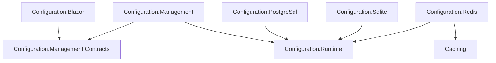

# Typed Runtime Configuration

Use the .NET 10/11 runtime/PostgreSQL/SQLite packages for narrow, non-secret operational
controls that must change without restarting a host. Immutable deployment configuration remains
the default. Connections, authentication, DI topology and database/schema selection are not live controls.

The [ADR](adr-0001-runtime-configuration.md) separates the implemented slice from the broader
proposal. The optional [typed management API](runtime-configuration-management.md) is implemented
as a separate package, with an optional [typed Blazor editor](../src/CasCap.Common.Configuration.Blazor/README.md).
Typed restore commands, Redis outbox projection and Azure authorities are not implemented.
The optional Redis adapter provides bounded cache-aside acceleration only.

## Choose a Read Mode

| Mode | Dependencies | Freshness |
| --- | --- | --- |
| Direct PostgreSQL | Runtime and PostgreSQL packages, PostgreSQL | Next successful poll, plus source/apply duration |
| Direct SQLite | Runtime and SQLite packages, durable local file | Next successful poll, plus source/apply duration |
| Optional cache-aside | Direct provider plus Redis package and shared CasCap caching | Cache age or independent durable reconciliation, then polling/source duration |

Install the selected provider with `dotnet add package CasCap.Common.Configuration.PostgreSql`
or `dotnet add package CasCap.Common.Configuration.Sqlite`. The Redis
dependency stays out of the direct-provider projects. Ordinary `IOptionsMonitor<T>.CurrentValue`
reads use accepted in-process state, not the database or Redis.

Two replicas with the default five-second interval perform about **0.4 aggregate durable reads per
second** in direct mode, not a read every 0.4 seconds. Polls currently fetch one full bounded snapshot.
Redis can reduce repeated reads but adds dependencies and permitted staleness; it is not required
for this small workload, and the trial does not claim measured production speedup.

## Dependency Graph

Arrows show direct package references, with the `CasCap.Common.` prefix omitted.
Browser code depends only on the management contracts; database and cache dependencies stay server-side.



## Define a Typed Contract

Use a small DTO with explicit validation. For example:

```csharp
using System.ComponentModel.DataAnnotations;

public sealed record Controls
{
    [Range(0, 5)]
    public int Verbosity { get; init; } = 2;

    public bool FeatureEnabled { get; init; }
}
```

The codec rejects unknown JSON members, invalid member types, undefined enum values, cycles and
oversized/deep graphs. It runs recursive DataAnnotations, `IValidatableObject` and registered
`IValidateOptions<T>` validators before typed persistence and activation.
The DTO JSON limit is 65,536 UTF-8 bytes; maximum JSON depth is 32. Cross-property validation belongs
in the DTO or a registered validator, not in an arbitrary string setter.

Use `[JsonConverter]` on enum members/types when the wire format requires enum names.
Treat returned options as immutable, including nested collections.

## Register the Host

In the existing `Program.cs` or `AppHost` composition root:

```csharp
using CasCap.Common.Configuration.Runtime.Models;
using CasCap.Common.Extensions;

var builder = WebApplication.CreateBuilder(args);
var connection = builder.Configuration.GetConnectionString("RuntimeConfiguration")
    ?? throw new InvalidOperationException("Runtime configuration connection is required.");

builder.Services.AddPostgresRuntimeConfiguration(
    new RuntimeConfigurationOptions
    {
        Scope = new RuntimeConfigurationScope("example-application", builder.Environment.EnvironmentName),
        ContractId = "controls",
        ContractVersion = 1,
        RefreshInterval = TimeSpan.FromSeconds(5),
        StartupTimeout = TimeSpan.FromSeconds(15),
    },
    connection,
    new Controls { Verbosity = 2 });
```

Register before dependent hosted services. One contract per host is supported; duplicate registration
fails. Application and environment are required, case-sensitive strings of at most 100 characters,
not fixed environment enums. Use the host's actual environment consistently when publishing.
Contract ID is at most 100 characters and version is positive. Polling supports 100 milliseconds to
one hour; initial-load timeout is positive and at most five minutes.

The runtime root is isolated from deployment configuration. It does not merge live values into the
host's whole `IConfiguration`, replace Key Vault, or update unrelated options. A valid initial durable
revision is required before enabled startup; an unavailable authority or invalid initial value fails
startup rather than using a success-shaped default.

## Experimental Native AOT

The runtime core and direct PostgreSQL/SQLite adapters have an opt-in **source-build pilot**.
Normal builds and existing registrations retain managed .NET 10/11 behavior. The .NET 10 assets
use EF 10.0.14/Npgsql EF 10.0.3; .NET 11 assets and the native pilot use EF/Npgsql EF 11.0.0.
Native AOT support remains experimental, not production-certified.
The MVC management API, Blazor editor, Redis decorator and bootstrap configuration package are
outside this pilot.

Use the overload accepting generated `JsonTypeInfo<T>` and an explicit `IValidateOptions<T>`
contract validator. The codec still enforces the 65,536-byte limit, JSON depth 32 and unknown-member
rejection. Instead of reflective recursive DataAnnotations, the supplied validator must validate
the **entire** graph: nested objects, collection items, enum bounds and cross-property invariants.
Use an options-validation generator with the appropriate nested-validation attributes or write
that validator explicitly. Skipping the default options name is an error. Separately registered
validators still run.

For the flat `Controls` DTO above, registration can use:

```csharp
using Microsoft.Extensions.Options;
using System.Text.Json.Serialization;

services.AddPostgresRuntimeConfiguration(
    settings, connection, new Controls(),
    ControlsJsonContext.Default.Controls,
    new ValidateOptions<Controls>(Options.DefaultName,
        value => value.Verbosity is >= 0 and <= 5, "Verbosity must be between zero and five."));

[JsonSerializable(typeof(Controls))]
public sealed partial class ControlsJsonContext : JsonSerializerContext;
```

Use the host's service collection, `RuntimeConfigurationOptions` settings and connection string
from the registration above. The SQLite overload
accepts the same metadata/validator arguments. Keep migrations in a separate managed process;
native publication does not make `Database.Migrate` supported.

### Published-Process Integration Probe

From the repository root, with Docker running Linux containers:

```powershell
docker compose --profile configuration-aot-tests run --rm configuration-aot-tests
# Stop PostgreSQL afterward only if this run started it.
docker compose --profile tests stop postgres-tests
```

The [Compose profile](../docker-compose.yml) uses the existing disposable PostgreSQL test service,
not another database. It publishes the separate [console test host](../src/CasCap.Common.Configuration.Aot.TestHost/README.md)
twice and runs eight explicit xUnit cases: four PostgreSQL/SQLite times JIT/AOT parity cases and
four paired dynamic-query probes. Each process asserts its
actual dynamic-code capability. SQLite uses fixture-owned temporary files; the PostgreSQL fixture
creates/drops GUID-named databases. A managed subprocess applies migrations; the native executable
excludes that migration branch at compile time. No MVC host or test runner is native-published.

The shared scenarios check first and subsequent publication, history, stale writes/no phantom
history, first/existing-head writer races, scope isolation, invalid nested/enum/cross-property
values, malformed/unknown JSON, payload limits, real monitor notifications, complete collection
replacement, expiry/baseline restoration and persisted state after a fresh process starts.
Observed validation is .NET 11, `linux-x64` on Linux amd64; .NET 10 retains managed validation only.

### Examples of Queries That Require Runtime Compilation

The fixture's `DynamicQueryProbe` runs the **same** code and persisted rows in both executables:

| Scenario | EF construct | JIT result | Expected native rejection |
| --- | --- | --- | --- |
| `dynamic-filter` | Runtime-built `Expression<Func<long, bool>>`, `Where`, ordering and paging | Revisions 3, 4, 5 | EF `QueryNotPrecompiled` |
| `dynamic-aggregate` | Runtime-composed predicate, self-join, `GroupBy`, `Sum` and aggregate filter | Sum 12 | EF `QueryNotPrecompiled` |

See the [exact query code](../src/CasCap.Common.Configuration.Aot.TestHost/Services/DynamicQueryProbe.cs).
The predicate threshold uses a captured value rather than creating constant-shaped queries.
Each paired test seeds/migrates through JIT, asserts the actual SQL-backed JIT result, then runs
the native binary against that same scope. Only `InvalidOperationException` whose message equals
EF's `CoreStrings.QueryNotPrecompiled` is accepted; provider, connectivity, missing-native-code
or unrelated failures fail the test. Unexpected native success also fails, flagging a changed
compatibility boundary rather than pretending the example is still blocked.

This is **not** a claim that joins, grouping, aggregation or parameterized predicates inherently
fail under AOT. Fixed complete query sites may be precompiled; runtime-built expression trees and
conditional `IQueryable` composition cannot use those fixed interceptors. These deliberate
negative examples live only in the test executable, without changing the production adapters.

### Build and Distribution Boundaries

The runner sets `ExperimentalConfigurationAot=true` as an environment property for native
publishing, so the separate design-time workspace sees the same settings. That variant selects
only `net11.0` in the three source projects and enables EF Tasks in each query-owning adapter.
The regular build still targets both frameworks and does not run experimental generation.
Generated code stays under `obj`; do not commit it or hand-patch it.
EF 11 generation is controlled by `EFScaffoldModelStage`/`EFPrecompileQueriesStage`; the retired
`EFOptimizeContext` property is not used. Both adapters reference EF Design directly.

EF 10 needs non-generic complete method-chain query sites with local captured values. Explicit
revision projections and required-member constructors avoid its no-tracking materializer bugs.
The adapters link the [shared EF source](../src/Shared/Configuration.EntityFrameworkCore) for those
queries and revision entities. Each compiles its own concrete provider-specific types and query
sites, retaining existing namespaces and separate EF generation; no shared EF runtime package or
duplication exclusion is introduced. Provider models, migrations and transaction logic remain local.
Storage entities are public because generated accessors are public, and the head is unsealed
because the generated tracked materializer performs an interface cast. SQLite date properties
have explicit typed default comparers to avoid lazy runtime generic creation. PostgreSQL's .NET 11
mapping converts UTC `DateTimeOffset` values to UTC `DateTime` provider values (and back), avoiding
EF/Npgsql 11's generated nullable timestamp comparer mismatch. EF preserves null expiry values
without invoking the converter. The database still stores `timestamp with time zone`.
The .NET 11 JSONB mapping also explicitly retains string provider values and comparers; Npgsql's
generated default otherwise selects `JsonElement`, causing a lazy native comparer failure.
None of these
changes alters tables, column types, history or transaction boundaries.

The probe deliberately keeps EF's substantial compiler/linker warnings visible. Known generated
documentation/nullability warnings are not errors only in the experimental
adapter build; native analysis warnings are not fatal only for this test executable. The regular
warning-as-error policy is unchanged. Passing these scenarios is **not** warning-free AOT
certification, a production recommendation, a performance benchmark or validation of other
architectures/runtime images.
EF 11 no longer emits the legacy interceptor diagnostic in this probe, so its `CS9270`
warning exception was removed. Substantial trimming/native diagnostics remain.

Normal prebuilt NuGet assemblies do not acquire interceptors when a consuming application sets
this switch. Use source project references for the pilot; packaged-consumer AOT distribution still
needs separate validation. EF 11 migration does not remove the native warning or production gates.
No package is marked `IsAotCompatible`.

## Provision PostgreSQL Externally

The independently owned EF context uses `cascap_config` in either a standalone database or the
existing application database. Its objects are `revisions`, `heads` and `__ef_migrations_history`.
No runtime migration or automatic initial publication occurs.

From the repository root, an operator first generates and reviews offline SQL:

```powershell
dotnet ef migrations script --project src\CasCap.Common.Configuration.PostgreSql --configuration Release --context RuntimeConfigurationDbContext
dotnet ef migrations has-pending-model-changes --project src\CasCap.Common.Configuration.PostgreSql --configuration Release --context RuntimeConfigurationDbContext
```

The design-time factory uses a synthetic offline connection and does not start the application.
Keep `dotnet-ef` aligned with the resolved EF runtime version. Apply the reviewed SQL or migration
through an externally serialized, separately authorized operation against the exact target.
Never apply the test fixture to an application database.

Keep migration, publisher and reader identities separate:

- Reader: schema USAGE and SELECT on `heads` and `revisions`; no DDL or journal mutation rights.
- Publisher: read scopes/history, INSERT revisions and INSERT/UPDATE heads in one transaction.
  Do not grant UPDATE/DELETE on historical revisions.
- Migrator: owns required DDL and migration history. Do not run every replica with this identity.

Schema separation is not permission enforcement. Reusing an application identity can be an
explicitly accepted trial tradeoff, but it does not remove that account's existing privileges.
All records are non-secret; never use configuration history as a credential store.

## Provision SQLite Externally

Use the [SQLite source adapter](../src/CasCap.Common.Configuration.Sqlite/README.md) instead of
PostgreSQL by importing `CasCap.Common.Extensions` and calling
`AddSqliteRuntimeConfiguration` with the same settings/baseline and a file connection string
such as `Data Source=configuration.db;Pooling=False;Default Timeout=5`.

Its independently owned context has real provider-specific migrations for
`cascap_config_revisions`, `cascap_config_heads` and `cascap_config_migrations_history`.
It preserves unrelated application tables in a shared file. EF's SQLite migrator additionally owns
`__EFMigrationsLock`. Apply migrations externally and serialize migration execution, including
other contexts using the same file; runtime startup never modifies schema.

```powershell
dotnet ef migrations script --project src\CasCap.Common.Configuration.Sqlite --configuration Release
dotnet ef migrations has-pending-model-changes --project src\CasCap.Common.Configuration.Sqlite --configuration Release
```

The design-time factory is offline; choose the actual file separately when applying reviewed
migrations. SQLite does not support EF idempotent scripts. One writer holds a non-deferred
transaction across head validation, journal append and head advancement. Stale heads,
primary-key races and SQLite busy/locked errors are explicit `DbUpdateConcurrencyException`;
reload the durable head before retrying. Other database errors are not mislabeled as conflicts.
File permissions apply to the entire database; a table prefix is ownership, not authorization.
Keep durable files local and back them up operationally; do not share writable WAL files across
nodes or expect Redis to reconcile independent files.

## Publish and Read History

Use the concrete typed writer, with an audit actor derived from an authorized operator/principal:

```csharp
using CasCap.Common.Configuration.PostgreSql.Services;

var writer = services.GetRequiredService<PostgresRuntimeConfigurationStore<Controls>>();
var initial = await writer.PublishAsync(
    new Controls { Verbosity = 2 },
    expectedRevision: 0,
    actor: "example-operator",
    reason: "Initial baseline",
    cancellationToken: cancellationToken);

var temporary = await writer.PublishAsync(
    new Controls { Verbosity = 4 },
    expectedRevision: initial.Revision,
    actor: "example-operator",
    reason: "Temporary diagnostic control",
    expiresAtUtc: timeProvider.GetUtcNow().AddMinutes(2),
    cancellationToken: cancellationToken);

var earlier = await writer.ReadRevisionAsync(initial.Revision, cancellationToken);
```

Here `services` is the initialized host/operator service provider and `timeProvider` is its clock.
Provision the initial record before starting an enabled reader host; a dedicated operator process
can resolve the writer without starting reader hosted services.

Expected revision 0 means no head exists. A mismatch or competing writer throws
`DbUpdateConcurrencyException`; do not automatically retry with a newly read revision or blindly
retry an uncertain commit. Actor/reason must be nonempty and fit 200/500 characters; expiry must be
in the future. A rejected typed publication must not append a journal row.

Publication atomically appends the journal and advances its scoped head. Success means committed,
not yet applied by every host. Historical reads never move the active head.
To restore earlier content now, validate and publish that content as a **new** revision; a typed
restore/provenance API is deferred. Never move a head backward or edit old payloads.

Direct SQL is an operator-only escape hatch, not a management API. It must preserve the same
transaction/scope/expected-head checks, and it bypasses typed writer validation. Readers still
validate candidates. The cache trial does not require writers to invalidate entries; that increases
permitted delay as documented in its [README](../src/CasCap.Common.Configuration.Redis/README.md).

## Consume and Apply Safely

Inject standard `IOptionsMonitor<Controls>`. Capture one `CurrentValue` aggregate per operation
where consistency requires it; do not repeatedly read different revisions during one operation.
Subscriptions are disposable. A host-owned consumer should subscribe before reading the initial
value, serialize its initial/change application when necessary, and dispose the subscription at stop.

Only reload-safe operations belong in callbacks, such as updating the logging pipeline's existing
level switch. Standard options notifications are not a transaction: one failing listener does not
roll back other listeners or undo a consumer's side effects. Keep callback errors distinct from
invalid configuration and storage failures; application-specific apply/status behavior stays in
the consumer. Disabling a feature in the browser is not authorization for its server endpoint.

Complete dictionary replacement removes deleted collection keys. An unchanged serialized DTO emits
no reload notification even if its durable revision/expiry metadata changed.

## Failure and Expiry Contract

| Situation | Reader behavior |
| --- | --- |
| Missing, unavailable or invalid initial publication | Enabled startup fails |
| Invalid/unsupported refresh, durable revision regression or database failure | Logs sanitized failure type and retains accepted controls |
| Accepted temporary override reaches expiry | Returns to immutable startup baseline before a poll or after a failed refresh |
| Dependency recovers with a newer valid revision | Normal reconciliation applies it without replacing the process |
| Redis unavailable, invalid entry or stale/regressed cache | Trial consults the durable authority; if that fails, normal reader retention applies |
| Host shutdown during a store read | Propagates cancellation; refreshes do not overlap |

Expiry returns to the **supplied startup baseline**, not necessarily revision 1. It does not append a
revert revision or change the durable head. An already accepted expiry still applies after a newer
invalid head. Poll scheduling and in-flight I/O can delay it: there is no hard real-time deadline.
Database restore/generation replacement under running readers is unsupported.

For evidence, use a temporary level distinct from startup. Observe actual consumer behavior before,
during and after expiry on the same host identities. Same-value expiry and unchanged notification
counts cannot prove that reconciliation occurred. The short live logging check proved effective
switch/filter transitions, not exported-event delivery, all future failures or a long-duration soak.

## Validate and Troubleshoot

The [acceptance suite](../src/CasCap.Common.Configuration.Runtime.Tests/README.md) runs against
disposable PostgreSQL/Redis, isolated SQLite files and the permanent `WebApplicationFactory` stub. Tests exercise validation,
concurrency, migration shape, isolation, real database connection refusal/recovery, replicas,
replacement, local expiry, cancellation and the optional cache trial.

Check bootstrap application/environment/contract/version, applied migration and scoped head before
enabling a host. On refresh failures, inspect the sanitized failure type and use an authorized
operator connection to inspect records; do not export payloads, connections or provider exception
details into logs. If a valid publication appears delayed, check polling, cache maximum age and
independent reconciliation settings. Never flush a shared Redis database to diagnose one key.

Feature controls still require application-owned authorization, health and audit policies.
The optional [management API](../src/CasCap.Common.Configuration.Management/README.md) and
[typed Blazor editor](../src/CasCap.Common.Configuration.Blazor/README.md) provide read, validation
and expected-revision publication for the host's one registered browser-safe DTO/scope.
See the [management wire contract](runtime-configuration-management.md) for policies, cookies,
antiforgery, safe errors and committed-versus-applied semantics. Provider-only consumers acquire
neither dependency. History browsing, dedicated restore, promotion and live activation dashboards
remain deferred; no consumer UI rollout or package release is implied by these source projects.
