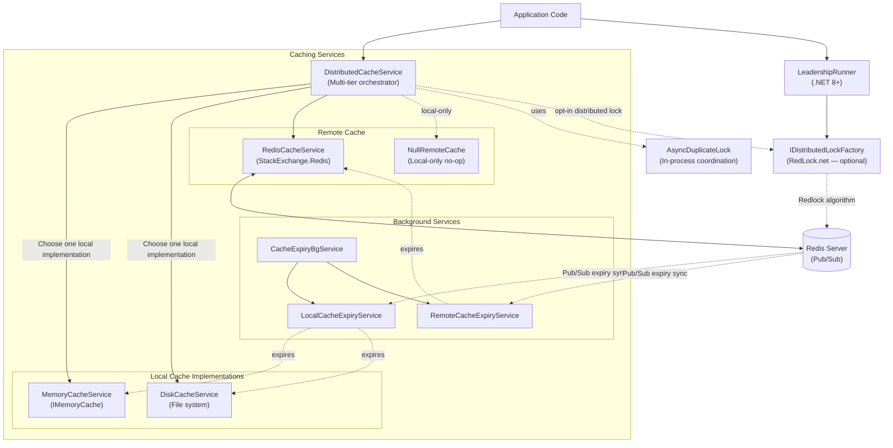

# CasCap.Common.Caching

Multi-tier distributed caching library implementing the cache-aside pattern with support for Memory, Disk, and Redis cache layers.

## Installation

```bash
dotnet add package CasCap.Common.Caching
```

**Target frameworks:** `netstandard2.0`, `net8.0`, `net9.0`, `net10.0`

## Usage

For local memory caching, disable the remote tier explicitly:

```csharp
using System;
using CasCap.Common.Models;
using Microsoft.Extensions.DependencyInjection;
using Microsoft.Extensions.Hosting;
using AppCache = CasCap.Common.Abstractions.IDistributedCache;

var builder = Host.CreateApplicationBuilder(args);
builder.Services.AddCasCapCaching(options =>
    options.RemoteCache = options.RemoteCache with { IsEnabled = false });

using var host = builder.Build();
await host.StartAsync();
var cache = host.Services.GetRequiredService<AppCache>();

await cache.Set("greeting", "Hello", slidingExpiration: TimeSpan.FromMinutes(5));
Console.WriteLine(await cache.Get<string>("greeting")); // Hello
await host.StopAsync();
```

[`CasCap.Common.Abstractions.IDistributedCache`](https://github.com/f2calv/CasCap.Common/blob/main/src/CasCap.Common.Caching/Abstractions/IDistributedCache.cs)
is the object-cache API, not Microsoft's byte-cache
interface with the same name. `Get<T>` can take an asynchronous factory for a cache miss. `Set`,
`Delete` and `DeleteAll` affect the enabled layers.

To use application configuration, replace the registration with
`builder.Services.AddCasCapCaching(builder.Configuration)`. The section defaults to
`CasCap:CachingConfig`. Overloads also accept a `CachingConfig` instance or an `Action<CachingConfig>`.
A non-empty connection string opens Redis during registration and returns its `ConnectionMultiplexer`
for reuse. Without one, registration supplies `NullRemoteCache`; it does not automatically turn off
`RemoteCache.IsEnabled`.

Select memory or disk with the `LocalCacheType` argument. This selects the implementation;
enabling `DiskCache` in JSON alone does not switch from memory to disk.

## Cache Layers

| Service | Description |
| --- | --- |
| `DistributedCacheService` | Reads local first, then an enabled remote tier, then an optional factory; supports opt-in Redis locking |
| `RedisCacheService` | [`IRemoteCache`](https://github.com/f2calv/CasCap.Common/blob/main/src/CasCap.Common.Caching/Abstractions/IRemoteCache.cs) implementation wrapping StackExchange.Redis with optional Lua script support |
| `NullRemoteCache` | No-op `IRemoteCache` implementation used for local-only caching. Redis infrastructure properties throw `NotSupportedException` |
| `MemoryCacheService` | [`ILocalCache`](https://github.com/f2calv/CasCap.Common/blob/main/src/CasCap.Common.Abstractions/Abstractions/ILocalCache.cs) implementation backed by `IMemoryCache` |
| `DiskCacheService` | `ILocalCache` implementation persisting cache entries to disk |
| `CacheExpiryBgService` | Coordinates expiry subscribers when Redis is registered and `CacheExpiryServiceEnabled` is true |
| `LocalCacheExpiryService` | Handles local cache entry expiration. Disable via `LocalCacheExpiryServiceEnabled` |
| `RemoteCacheExpiryService` | Handles remote cache entry expiration. Disable via `RemoteCacheExpiryServiceEnabled` |

## Leadership Election

The current checkout also provides
[`ILeadershipRunner`](Abstractions/ILeadershipRunner.cs) on .NET 8 and later. This API is provisional
and not yet available in the published package; use local Debug project references while validating
consumers, without publishing a package for each contract refinement.

Inject the runner into a background feature and await
`RunAsync("example-worker", RunProtectedWorkAsync, stoppingToken)`. All replicas of the same worker
must use the same logical resource. `RunProtectedWorkAsync(CancellationToken)` must stay active until
cancelled, pass its token to all I/O and child work, and await cleanup before returning.

- Registration uses the existing Redis connection, database, key format and distributed-lock factory.
  Configure Redis and `DistributedLockingEnabled: true`; resolving an elected worker without a
  factory fails rather than running unprotected. Local-only caching itself still needs no Redis.
- Leadership uses `Redlock.GetTimings(RedlockProfiles.LeaderElection)`; short cache-miss locks still
  use root timings and never enter the election loop.
- `Redlock.LeadershipCheckIntervalMs` defaults to `1000`, and controls lease-state observation only.
  RedLock.net renews the lease. A failed acquisition waits the profile retry interval before
  contending again.
- Observed loss cancels the worker, awaits its cleanup, disposes the lease, then reacquires.
  Graceful shutdown awaits cleanup before releasing a still-held lease.
- Worker failures and unexpected normal completion propagate instead of restarting silently.
  Cleanup has no runner timeout: configure the host and container termination budgets explicitly.
  An uncooperative worker is not abandoned and no replacement run starts while it is still active.
- Lease polling has a detection delay; it is not downstream fencing or an exactly-once guarantee.

All caching registration overloads expose the same `CachingConfig.Redlock` instance through
`IOptions<RedlockConfig>`. Repeated registration preserves the first configuration. Root timings,
named profile timings and the leadership check interval are validated through the caching options.

## Configuration

| Type | Description |
| --- | --- |
| `CachingConfig` | Main configuration record — `RemoteCacheConnectionString`, `PubSubPrefix`, `MemoryCacheSizeLimit`, `UseBuiltInLuaScripts`, `DiskCacheFolder`, `ExpirationSyncMode`, `DistributedLockingEnabled`, `CacheAsideDisabled`, `CacheKeyFormat`, `HealthCheckRedis`, `CacheExpiryServiceEnabled`, `LocalCacheExpiryServiceEnabled`, `RemoteCacheExpiryServiceEnabled`, `Redlock` |
| `RedlockConfig` | Timing parameters for Redis distributed locks with named profile support — root defaults (`ExpiryMs` 5s, `WaitMs` 5s, `RetryMs` 250ms) tuned for cache-miss protection. `RedisKeyFormat` for lock key prefixing. Built-in `LeaderElection` profile (30s/60s/5s) for long-lived locks. Custom profiles via `Profiles` dictionary |
| `RedlockProfiles` | Well-known profile name constants — `CacheMiss`, `LeaderElection` |
| `RedlockTimingProfile` | Timing values for a single named lock profile — `ExpiryMs`, `WaitMs`, `RetryMs` |
| `CacheParameters` | Per-layer enablement, database, startup clearing and serialization |

`CacheParameters` exposes `IsEnabled`, `DatabaseId`, `ClearOnStartup` and `SerializationType`;
entry lifetimes are passed to `Get` or `Set`, not stored in this record.
`ClearOnStartup` defaults to false. Enabling it can delete existing cache data.

Important defaults:

| Setting | Default |
| --- | --- |
| `RemoteCacheConnectionString` | null; no Redis registration |
| `MemoryCache.IsEnabled`, `DiskCache.IsEnabled`, `RemoteCache.IsEnabled` | true; select and configure layers deliberately |
| `MemoryCache.SerializationType` | `None` |
| `DiskCache.SerializationType` | `Json` |
| `RemoteCache.SerializationType` | `MessagePack` |
| `LocalCacheInvalidationEnabled` | true |
| `CacheExpiryServiceEnabled`, `LocalCacheExpiryServiceEnabled`, `RemoteCacheExpiryServiceEnabled` | true |
| `ExpirationSyncMode` | `None` |
| `DistributedLockingEnabled`, `UseBuiltInLuaScripts`, `CacheAsideDisabled` | false |
| `HealthCheckRedis` | `Liveness`; Redis health-check registration is .NET 8+ only |
| `MemoryCacheSizeLimit` | null; no configured limit |
| `CacheKeyFormat` | `{0}` |
| `Redlock.LeadershipCheckIntervalMs` | `1000`; .NET 8+ leadership observation only |

`PubSubPrefix` distinguishes this instance's own invalidation messages; choose a distinct value per
instance when overriding it. `HealthCheckRedis: None` suppresses Redis check registration.

### Serialization and Expiration Modes

| Enum | Values |
| --- | --- |
| `CacheType` | `None`, `Memory`, `Disk`, `Redis` |
| `SerializationType` | `None`, `Json`, `MessagePack` |
| `ExpirationSyncType` | `None`, `ExpireViaPubSub`, `ExtendRemoteExpiry` |

## Service Architecture

Multi-tier caching infrastructure with cache-aside pattern:



## Configuration Examples

The configuration overload reads `CasCap:CachingConfig`. Omitted properties retain record defaults.
The examples below are alternatives, not a set of sections to merge indiscriminately.

### Minimal — local memory cache only

```json
{
  "CasCap": {
    "CachingConfig": {
      "RemoteCache": {
        "IsEnabled": false
      }
    }
  }
}
```

### Redis remote cache with JSON serialization

```json
{
  "CasCap": {
    "CachingConfig": {
      "RemoteCacheConnectionString": "redis.example.com:6379,abortConnect=false",
      "RemoteCache": {
        "SerializationType": "Json"
      }
    }
  }
}
```

### Disabling the expiry background services

Each background service can be switched off independently. `CacheExpiryServiceEnabled: false` prevents the `CacheExpiryBgService` hosted service being registered at all; the two granular toggles keep the hosted service registered but skip the individual subscriber.

```json
{
  "CasCap": {
    "CachingConfig": {
      "RemoteCacheConnectionString": "redis.example.com:6379,abortConnect=false",
      "CacheExpiryServiceEnabled": true,
      "LocalCacheExpiryServiceEnabled": false,
      "RemoteCacheExpiryServiceEnabled": true
    }
  }
}
```

### Distributed locking enabled (cache-miss protection)

```json
{
  "CasCap": {
    "CachingConfig": {
      "RemoteCacheConnectionString": "redis.example.com:6379,abortConnect=false",
      "DistributedLockingEnabled": true,
      "RemoteCache": {
        "SerializationType": "Json"
      }
    }
  }
}
```

### Distributed locking with custom Redlock profiles

```json
{
  "CasCap": {
    "CachingConfig": {
      "RemoteCacheConnectionString": "redis.example.com:6379,abortConnect=false",
      "DistributedLockingEnabled": true,
      "RemoteCache": {
        "SerializationType": "Json"
      },
      "Redlock": {
        "ExpiryMs": 5000,
        "WaitMs": 5000,
        "RetryMs": 250,
        "Profiles": {
          "LeaderElection": {
            "ExpiryMs": 30000,
            "WaitMs": 60000,
            "RetryMs": 5000
          }
        }
      }
    }
  }
}
```

### Extended Configuration

```json
{
  "CasCap": {
    "CachingConfig": {
      "RemoteCacheConnectionString": "redis.example.com:6379,abortConnect=false,connectTimeout=1000",
      "DistributedLockingEnabled": true,
      "CacheKeyFormat": "Example:{0}",
      "MemoryCacheSizeLimit": 500,
      "UseBuiltInLuaScripts": true,
      "DiskCacheFolder": "./cache",
      "ExpirationSyncMode": "ExpireViaPubSub",
      "MemoryCache": {
        "IsEnabled": true,
        "ClearOnStartup": false,
        "SerializationType": "None"
      },
      "DiskCache": {
        "IsEnabled": false,
        "SerializationType": "Json"
      },
      "RemoteCache": {
        "IsEnabled": true,
        "DatabaseId": 1,
        "ClearOnStartup": false,
        "SerializationType": "MessagePack"
      },
      "Redlock": {
        "RedisKeyFormat": "Example:RedLock:{0}",
        "ExpiryMs": 5000,
        "WaitMs": 5000,
        "RetryMs": 250,
        "Profiles": {
          "LeaderElection": {
            "ExpiryMs": 30000,
            "WaitMs": 60000,
            "RetryMs": 5000
          },
          "LongRunningJob": {
            "ExpiryMs": 120000,
            "WaitMs": 30000,
            "RetryMs": 10000
          }
        }
      }
    }
  }
}
```

Replace the example endpoint and supply authentication through a secret provider, not tracked JSON.
For Redis expiration housekeeping, enable expired-key event notifications on the server, such as
`notify-keyspace-events Ex`. Run the application host so its enabled subscribers execute.

Distributed locking coordinates factory execution across instances but is not a guarantee of
exactly-once work. Handle a missing cache result if lock acquisition fails. Use `CacheAsideDisabled`
to call the factory directly; sets and deletes then become no-ops.
