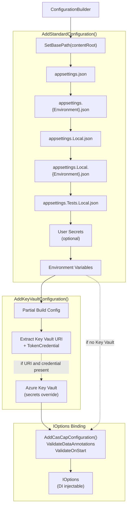

# CasCap.Common.Configuration

Configuration bootstrapping helpers for .NET applications — standard `IConfiguration` pipeline setup, Azure Key Vault integration, and validated `IOptions<T>` binding for `IAppConfig` records.

## Installation

```bash
dotnet add package CasCap.Common.Configuration
```

**Target frameworks:** `netstandard2.0`, `net8.0`, `net9.0`, `net10.0`

## Usage

In a .NET 8+ host, register an `IAppConfig` record to bind and validate its named section:

```csharp
using System.ComponentModel.DataAnnotations;
using CasCap.Common.Abstractions;
using CasCap.Common.Extensions;
using Microsoft.Extensions.Hosting;

var builder = Host.CreateApplicationBuilder(args);
builder.Services.AddCasCapConfiguration<ExampleConfig>();
await builder.Build().RunAsync();

public sealed record ExampleConfig : IAppConfig
{
    public static string ConfigurationSectionName => "Example";

    [Required]
    public string Greeting { get; init; } = "Hello";
}
```

Consumers inject `IOptions<ExampleConfig>` or `IOptionsMonitor<ExampleConfig>`.
The explicit-section overload, `AddCasCapConfiguration<ExampleConfig>("Example")`, also works on
.NET Standard 2.0.

On .NET 8+, `GetCasCapConfiguration<TConfig>()` eagerly binds and validates without registering DI
services. `AddAndGetCasCapConfiguration<TConfig>(configuration)` combines registration with that
eager read. A configuration delegate applies to registered options, not the separately bound
instance returned by the eager read.

## Configuration Examples

### Minimal Options

Add this section to the application's configuration:

```json
{
  "Example": {
    "Greeting": "Hello"
  }
}
```

### Standard Configuration Sources

For applications constructing their own configuration pipeline:

```csharp
using System.Reflection;
using CasCap.Common.Extensions;
using Microsoft.Extensions.Configuration;

var configuration = new ConfigurationBuilder()
    .AddStandardConfiguration("Development", Assembly.GetExecutingAssembly())
    .Build();
```

The base path is `AppDomain.CurrentDomain.BaseDirectory`. The base `appsettings.json` is required;
make sure it is copied to the output directory. Environment, local and test-local files are optional.
Pass no assembly to skip user secrets. Environment variables are added last by this helper;
it does not add command-line arguments.

### Optional Key Vault Provider

Call `AddKeyVaultConfiguration(vaultUri, credential)` after adding the base sources. The caller
supplies an Azure `TokenCredential`. A null URI or credential leaves the provider unregistered.
`AddKeyVaultConfigurationFrom` obtains that tuple from a snapshot of the sources already added.

Use a prefix manager when one vault serves several configuration sections:

```csharp
using CasCap.Common.Extensions;

var secretManager = new PrefixKeyVaultSecretManager(
    sourcePrefix: "Example--Worker",
    destinationPrefix: "Example",
    exclusiveRootPrefix: "Example");
```

Pass the manager to either Key Vault helper. `Example--Worker--Greeting` maps to `Example:Greeting`.
Other `Example--*` prefixes are excluded, while names outside that reserved root retain the default
Key Vault mapping. Without `exclusiveRootPrefix`, only the selected source prefix is loaded.

## Configuration Hierarchy

For a pipeline built with `AddStandardConfiguration` followed by a Key Vault helper, later
providers override earlier ones:



**Layering Priority** (later sources override earlier ones):

1. `appsettings.json`
2. `appsettings.{Environment}.json`
3. `appsettings.Local.json` (optional)
4. `appsettings.Local.{Environment}.json` (optional)
5. `appsettings.Tests.Local.json` (optional)
6. User Secrets (when an assembly is supplied)
7. Environment Variables
8. Azure Key Vault (if configured)

This is the helper's ordering, not a replacement for the defaults of every .NET host builder.
Adding providers later can change precedence. Keep local overrides and credentials outside Git.
