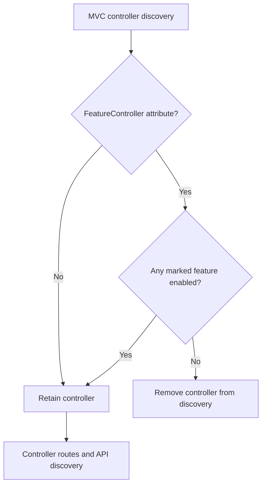

# CasCap.Common.Hosting.AspNetCore

ASP.NET Core hosting defaults for feature-gated controllers, Serilog logging, and OpenTelemetry metrics, traces, and logs.

## Installation

```bash
dotnet add package CasCap.Common.Hosting.AspNetCore
```

**Target frameworks:** `net8.0`, `net9.0`, `net10.0`

## Usage

In an ASP.NET Core application, enable the controller features this host can serve:

```csharp
using System;
using System.Collections.Generic;
using CasCap.Common.Abstractions;
using CasCap.Common.Extensions;
using Microsoft.AspNetCore.Builder;
using Microsoft.AspNetCore.Mvc;
using Microsoft.Extensions.DependencyInjection;

var builder = WebApplication.CreateBuilder(args);
var enabledFeatures = new HashSet<string>(StringComparer.OrdinalIgnoreCase) { "Reports" };
builder.Services.AddControllers().AddFeatureGatedControllers(enabledFeatures);

var app = builder.Build();
app.MapControllers();
app.Run();

[ApiController]
[FeatureController("Reports")]
[Route("api/reports")]
public sealed class ReportsController : ControllerBase
{
    [HttpGet]
    public IActionResult Get() => Ok(new { Status = "ready" });
}
```

## Feature-Gated Controllers

`[FeatureController(...)]` accepts one or more names. A marked controller is discoverable when any
name overlaps the supplied enabled set; unmarked controllers remain available. Use a case-insensitive
set consistently with the feature launcher. Register dependencies for every controller retained on
the host. Gating controls discovery; it is not authentication or authorization.

Use the same set with
[CasCap.Common.Services](https://github.com/f2calv/CasCap.Common/tree/main/src/CasCap.Common.Services)
when background features share those names. If controllers live in separate assemblies, application
part selection can gate entire assemblies instead.

## Service Architecture



## Serilog

`SerilogExtensions.GetBootstrapLogger()` provides early startup logging. Call
`builder.InitializeSerilog()` to configure the host pipeline, then initialize OpenTelemetry if
needed. This ordering matters: Serilog initialization clears existing logging providers.
Serilog reads the `Serilog` section and forwards events to Microsoft logging providers, including
the OpenTelemetry exporter.

The local source API also accepts an optional `configureLogger` callback, applied after the standard
defaults and configuration binding. A deliberately reloadable application can use it to attach a
per-host `LoggingLevelSwitch` to `MinimumLevel.ControlledBy`. This controls the actual pipeline,
including forwarding, rather than only console output. The application owns validation, monitor
subscription/disposal and its immutable startup baseline; existing calls retain their behavior.

| Extension | Description |
| --- | --- |
| `SerilogExtensions.GetBootstrapLogger()` | Creates a bootstrap console logger and wires `ApplicationLogging.LoggerFactory` |
| `SerilogWebApplicationBuilderExtensions.InitializeSerilog(builder, categoryName)` | Configures Serilog as the host pipeline and forwards events to registered logging providers |
| `LoggerConfiguration.AddCasCapDefaults(IConfiguration)` | Applies standard enrichers, console output, health-check filtering, and configuration binding |

`SerilogExtensions.ConsoleLevelSwitch` controls console verbosity independently from other sinks. It defaults to `Verbose`; interactive applications can temporarily raise it to `Warning` to prevent rendered output from interleaving with logs.

## OpenTelemetry

`InitializeOpenTelemetry` registers metrics, traces and logs with OTLP gRPC export. It takes an
[`IMetricsConfig`](https://github.com/f2calv/CasCap.Common/blob/main/src/CasCap.Common.Abstractions/Abstractions/_IMetricsConfig.cs),
`ApplicationMetadata`, and optional Redis connection, exporter authentication
and metric/trace customization callbacks.

| Extension | Description |
| --- | --- |
| `OpenTelemetryExtensions.InitializeOpenTelemetry(...)` | Registers OpenTelemetry metrics, traces, and logs with OTLP gRPC export |
| `MeterProviderBuilderExtensions.AddHistogramView(...)` | Registers explicit histogram bucket boundaries for a prefixed instrument |
| `MetricBoundaries.Symmetric(...)` | Mirrors positive boundaries into a signed set around zero |

Registration is skipped when `OtlpExporterEndpoint` is null. Development hosts register a Prometheus
exporter; exposing its endpoint still requires application setup. Non-development hosts add
ASP.NET Core, runtime and process metrics. HTTP client tracing is enabled in both environments;
ASP.NET Core and optional Redis tracing are added outside Development.

## Configuration Examples

The library consumes `IMetricsConfig`; it does not bind a fixed `AppConfig` section. The application
chooses an options type and section. This example uses `Telemetry`:

```csharp
using System;
using CasCap.Common.Abstractions;
using CasCap.Common.Extensions;
using CasCap.Common.Models;
using Microsoft.Extensions.Configuration;
using Serilog;

builder.InitializeSerilog();
var telemetry = builder.Configuration.GetSection("Telemetry").Get<TelemetryOptions>()
    ?? new TelemetryOptions();
builder.InitializeOpenTelemetry(telemetry, new ApplicationMetadata());

public sealed record TelemetryOptions : IMetricsConfig
{
    public string MetricNamePrefix { get; init; } = "example";
    public string OtelServiceName { get; init; } = "Example.App";
    public Uri? OtlpExporterEndpoint { get; init; }
}
```

Run these registrations before `builder.Build()` in the Usage example. Place the options type
after the program's top-level statements.

### No Telemetry Export

```json
{
    "Telemetry": {
        "MetricNamePrefix": "example",
        "OtelServiceName": "Example.App"
    }
}
```

### OTLP Export

```json
{
    "Telemetry": {
        "MetricNamePrefix": "example",
        "OtelServiceName": "Example.App",
        "OtlpExporterEndpoint": "http://otel-collector.example.com:4317"
    }
}
```

Use a caller-controlled endpoint and protect exporter credentials with a secret provider. Telemetry
can leave the application through the configured collector; review resource attributes and emitted
events before enabling it.
