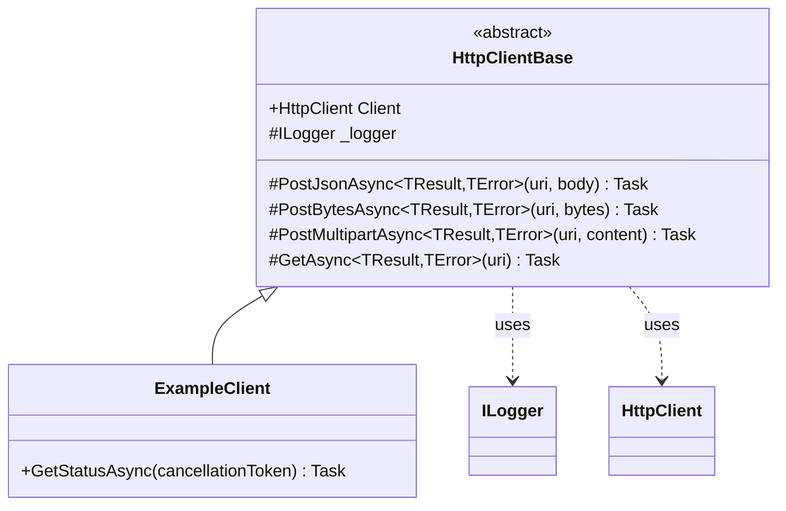

# CasCap.Common.Net

Abstract base class, extensions, and authentication handlers for building typed `HttpClient` wrappers and securing ASP.NET Core APIs.

## Installation

```bash
dotnet add package CasCap.Common.Net
```

**Target frameworks:** `netstandard2.0`, `net8.0`, `net9.0`, `net10.0`

The HTTP client base, authentication handler, resilience and auditing APIs require .NET 8+.
The .NET Standard target exposes the applicable network extensions.

## Usage

Derive a typed client from `HttpClientBase`, pass its logger and `HttpClient` to the base constructor,
and register it with `IHttpClientFactory`:

```csharp
using System;
using System.Net.Http;
using System.Threading;
using System.Threading.Tasks;
using CasCap.Common.Services;
using Microsoft.Extensions.DependencyInjection;
using Microsoft.Extensions.Hosting;
using Microsoft.Extensions.Logging;

var builder = Host.CreateApplicationBuilder(args);
builder.Services.AddHttpClient<ExampleClient>(client =>
    client.BaseAddress = new Uri("https://example.com/api/"));

public sealed class ExampleClient(ILogger<ExampleClient> logger, HttpClient client)
    : HttpClientBase(logger, client)
{
    public Task<(string? result, string? error)> GetStatusAsync(CancellationToken cancellationToken)
        => GetAsync<string, string>("status", cancellationToken: cancellationToken);
}
```

The GET and POST helpers take `TResult` and `TError` types. `string` returns the raw body and `byte[]` returns
the raw bytes, so an endpoint answering with audio or any other binary payload needs no separate
plumbing; other result types are deserialized as JSON. The `Async`-suffixed helpers return
`(result, error)`; their counterparts also return the status code and response headers. Both forms
are asynchronous. Handle the error result as well as the successful result.

| Request | Helpers |
| --- | --- |
| GET | `GetAsync`, `Get` |
| JSON POST | `PostJsonAsync`, `PostJson` |
| Binary POST | `PostBytesAsync`, `PostBytes` |
| Multipart POST | `PostMultipartAsync`, `PostMultipart` |

Calls support cancellation, timeouts and additional headers. The caller owns and disposes
`MultipartFormDataContent`, including its parts.

## Retry Safety

`AddStandardResilience` adds retry, circuit breaker and timeout handling. Its default
`HttpRetrySafety.SafeMethodsOnly` permits replay for idempotent methods. POST and PATCH retry only
for failures indicating the request never reached the server, not for timeouts or server errors.
Use `AllMethods` only when the endpoint's contract makes replay safe; use `Never` to disable retries.

```csharp
using CasCap.Common.Extensions;
using CasCap.Common.Models;

builder.Services.AddHttpClient<ExampleClient>()
    .AddStandardResilience(nameof(ExampleClient), HttpRetrySafety.SafeMethodsOnly);
```

Apply the extension to the same registration that configures the client's base address.

## Authentication

`BasicAuthenticationHandler` validates HTTP Basic credentials against `ApiAuthConfig`. Bind and
register those options through the application's authentication setup. Supply credentials through
a secret provider and use TLS. `AnonymousPathPrefixes` defaults to `["/healthz"]`; review bypasses
before exposing endpoints.

For outgoing requests, `NetExtensions` supplies `GetBasicAuthHeaderValue` and `SetBasicAuth`.
Do not log the resulting header.

## Configuration Examples

The client and resilience helpers use registration arguments, not a fixed JSON section. The
authentication handler consumes `CasCap:ApiAuthConfig` through options supplied by the application.
Provide its required username and password through a secret provider.

### Default Anonymous Probe Path

```json
{
  "CasCap": {
    "ApiAuthConfig": {
      "AnonymousPathPrefixes": ["/healthz"]
    }
  }
}
```

### Require Authentication on Every Path

```json
{
  "CasCap": {
    "ApiAuthConfig": {
      "AnonymousPathPrefixes": []
    }
  }
}
```

These fragments configure only path bypasses; neither is sufficient without the secret-backed
credentials and the application's authentication scheme registration.

## HTTP Auditing

`AddHttpAuditing(sourceName)` adds a handler that captures the request path/query, method, status,
elapsed time and request/response bodies. By default it registers `NullHttpAuditStore` and persists
nothing. Supply an
[`IHttpAuditStore`](https://github.com/f2calv/CasCap.Common/blob/main/src/CasCap.Common.Abstractions/Abstractions/IHttpAuditStore.cs)
implementation to retain records.

Captured bodies are JSON representations: absent, empty or whitespace-only content becomes
`null`; valid JSON objects, arrays and scalars retain their original text; plain text, HTML and
malformed JSON become JSON strings preserving the original content. Normalization changes only
the audit record, never the HTTP request or response. Stores can therefore accept ordinary empty
and non-JSON responses without attempting to parse them as raw JSON.

`FileHttpAuditStore` writes JSON under daily folders, defaulting to `http-audit` relative to the
working directory. It has no automatic retention policy. Capture is not redaction: paths, query
parameters and bodies may contain credentials or personal data. Assess the data and configure
appropriate access, retention and consent before enabling persistence. Body capture also buffers
content; do not assume it is suitable for large or streaming payloads.

## Network Extensions

`NetExtensions` supplies query-string construction, header replacement and response-header lookup.
These helpers do not register clients or send requests by themselves.

## Class Hierarchy

The typed client owns its API-specific methods; the base class handles common HTTP operations.



For the authentication and audit contracts, see
[CasCap.Common.Abstractions](https://github.com/f2calv/CasCap.Common/tree/main/src/CasCap.Common.Abstractions).
