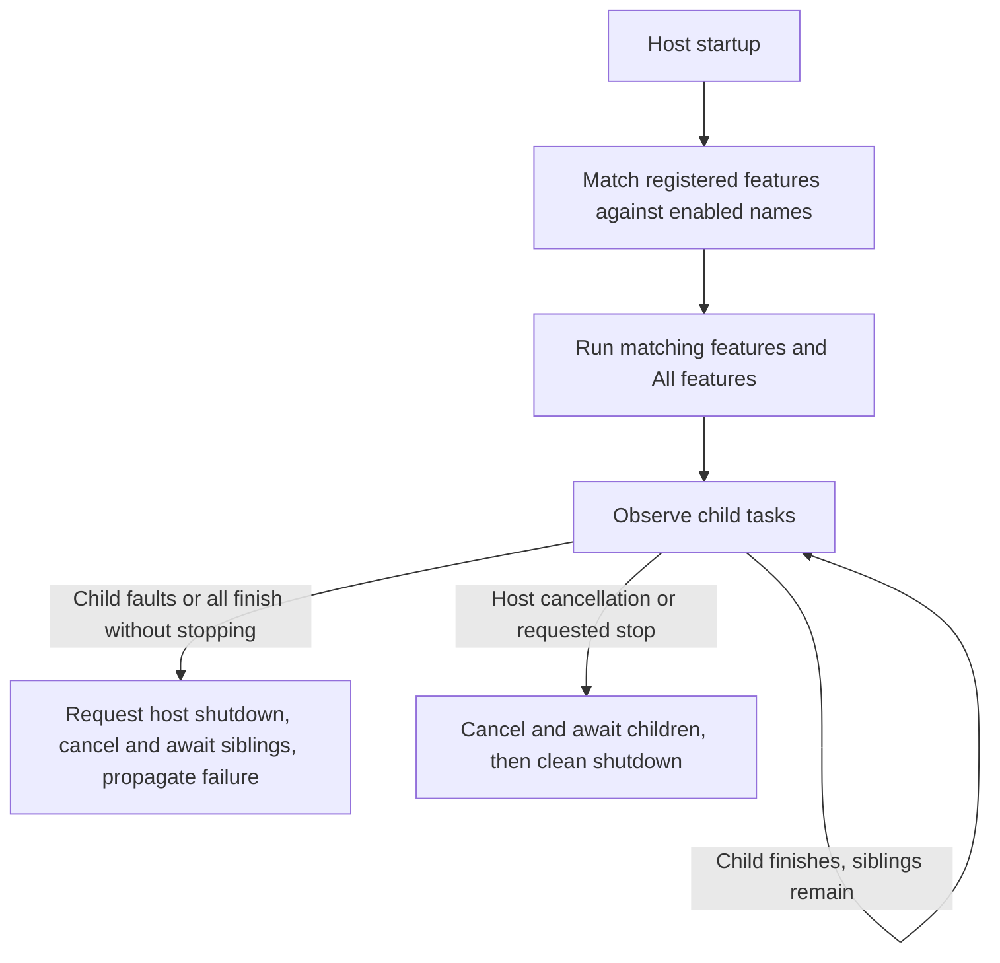

# CasCap.Common.Services

Run selected .NET background features by name, observe their lifecycle and expose assembly-backed application metadata.

## Installation

```bash
dotnet add package CasCap.Common.Services
```

**Target frameworks:** `net8.0`, `net9.0`, `net10.0`

## Usage

Register implementations as
[`IBgFeature`](https://github.com/f2calv/CasCap.Common/blob/main/src/CasCap.Common.Abstractions/Abstractions/IBgFeature.cs),
then supply the enabled names to the launcher:

```csharp
using System;
using System.Collections.Generic;
using System.Threading;
using System.Threading.Tasks;
using CasCap.Common.Abstractions;
using CasCap.Common.Extensions;
using Microsoft.Extensions.DependencyInjection;
using Microsoft.Extensions.Hosting;
using Microsoft.Extensions.Logging;

var builder = Host.CreateApplicationBuilder(args);
builder.Services.AddSingleton<IBgFeature, WorkerFeature>();
builder.Services.AddApplicationExitState();
builder.Services.AddFeatureFlagService(
    new HashSet<string>(StringComparer.OrdinalIgnoreCase) { "Worker" });

using var host = builder.Build();
await host.RunAsync();
return host.Services.GetApplicationExitCode();

public sealed class WorkerFeature(ILogger<WorkerFeature> logger) : IBgFeature
{
    public string FeatureName => "Worker";

    public async Task ExecuteAsync(CancellationToken cancellationToken)
    {
        while (!cancellationToken.IsCancellationRequested)
        {
            logger.LogInformation("Worker is active");
            await Task.Delay(TimeSpan.FromMinutes(1), cancellationToken);
        }
    }
}
```

Feature matching is case-insensitive. A feature named `IBgFeature.AlwaysEnabled` (`"All"`) runs
regardless of the selected set. Registration supplies `IOptions<FeatureFlagConfig>`; it does not
automatically read an `EnabledFeatures` JSON section.

### UTC Cron Scheduling

The current checkout also exposes `CoalescingScheduleRunner` in `CasCap.Common.Services`
(source-reference development until the next package publication). It accepts a parsed Cronos
expression, an injected `TimeProvider`, an awaited callback and a cancellation token.
Five-field expressions use minute precision; seconds require explicit `CronFormat.IncludeSeconds`.

```csharp
await CoalescingScheduleRunner.RunAsync(
    Cronos.CronExpression.Parse("0 * * * *"),
    TimeProvider.System,
    async (scheduledForUtc, token) => await RunJobAsync(scheduledForUtc, token),
    stoppingToken);
```

Occurrences are strictly after the cursor and use UTC. Each schedule runs sequentially; after
completion, missed occurrences are coalesced rather than replayed. Startup/manual execution,
distributed ownership, durable requests, retries and idempotency belong to the consumer.
Cancellation stops pending delays and is passed into callbacks; callback failures propagate.
`RunWithTimeoutAsync` cancels a cooperative operation and awaits its cleanup before reporting a
timeout. It does not forcibly abandon work that ignores cancellation.

## Service Architecture

- No matching features is a startup failure.
- A child may finish while siblings continue. Faults from enabled children propagate to the host.
- If all children finish before cancellation, the launcher reports an unexpected lifecycle failure.
- A finite job must request `IHostApplicationLifetime.StopApplication()` before returning.
- Host cancellation cancels and awaits outstanding features, including their cleanup.
- A child fault requests host shutdown immediately, then cancels and awaits its siblings before
  propagating the failure.
- A child fault marks `ApplicationExitState` as failed before requesting shutdown. The process entry
  point returns `GetApplicationExitCode()` after `RunAsync`, so graceful cleanup still completes but
  Kubernetes observes a nonzero result.
- `AddFeatureFlagService` registers the exit state automatically. Call
  `AddApplicationExitState()` directly in hosts that also need to report startup or non-feature
  outcomes through the same process boundary.
- A directly registered `BackgroundService` outside `FeatureFlagBgService` must mark the same state
  before requesting fatal shutdown, or use another supervisor that does.
- Align host and container termination budgets for uncooperative cleanup.



## Configuration Examples

### Feature Execution Only

The registration in Usage enables the selected features without periodic metadata logging.

### Feature Execution with Metadata

Pass `addApplicationMetadataService: true` to register `ApplicationMetadataBgService` and
`ApplicationMetadata`. The latter reads version, source revision and build context from assembly
attributes, not live Git state.

```csharp
builder.Services.AddFeatureFlagService(enabledFeatures, addApplicationMetadataService: true);
```

The optional metadata service binds `ApplicationMetadataConfig`. Its `LogInterval` defaults to one
minute and must be positive:

```json
{
  "ApplicationMetadataConfig": {
    "LogInterval": "00:05:00"
  }
}
```
